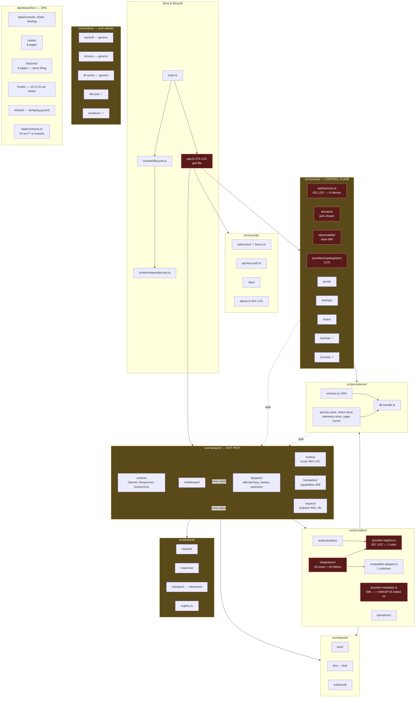
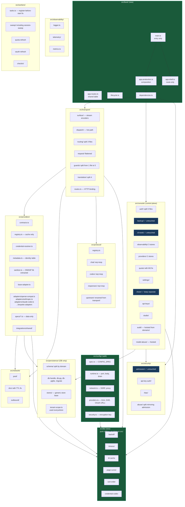

# Cartethyia — Cleanup & Restructure Plan

> **Status:** Analysis-only. No source code modified. Breaking changes accepted,
> including database schema. All findings backed by `codegraph_explore` + verified
> on-disk reads by five parallel subagents (reports in `.cleanup-work/`).
>
> **Baseline gates:** `bun run typecheck` clean, `bun test` 375/375 passing,
> zero import cycles in `src/transport/` and `dashboard/src/`, zero cross-app
> imports in dashboard. The repo compiles — this is a quality/structure
> cleanup, not a rescue.

## 0 — How to read this document

Each report under `.cleanup-work/` is the full evidence for one subsystem.
This file is the **synthesis**: Before/After trees, severity-ranked issue
tables, a mermaid of the proposed architecture, and a phased cutover plan.
Severity reflects **blast radius × correctness risk**, not line count.

| # | Report | LOC covered | Lines of findings |
|---|---|---|---|
| 1 | `01-transport.md` | ~15 000 | 778 |
| 2 | `02-providers-security-network.md` | ~20 000 | 1 013 |
| 3 | `03-persistence-console.md` | ~27 000 | 983 |
| 4 | `04-runtime-misc.md` | ~5 000 | 819 |
| 5 | `05-dashboard.md` | ~22 000 | 1 078 |
| | **Total** | **~89 000 LOC** | **4 671** |

---

## 1 — Top-level verdict

Cartethyia is a working, well-tested LLM gateway with **two real correctness
bugs**, **three memory leaks**, and a lot of structural debt that no test
catches because the behaviour is correct — just filed in the wrong drawer.
The repo's conventions (role-named files, no barrels, clean cutover, strict
TS) are **right**; they are just applied unevenly.

The cleanup splits into **four independent waves** (§7). Each wave is small
enough to review in one sitting and leaves the repo green between waves.

### 1.1 — Live bugs found (fix in Wave 0, before anything else)

| # | File | Bug | Impact |
|---|---|---|---|
| **B1** | `src/transport/request/preparer.ts:24` | `requestUsesWebSearch` duplicated; this copy calls `isWebSearchTool({name})` which reads `native_type`/`tool_type` that a `toolCall` ContentPart never carries → always `false` | **Search-fallback routing is dead.** `searchRouting` never reaches `RoutingEngine.plan()`. Verified by runtime probe. |
| **B2** | `src/providers/integrations/aihubmix.ts:15` | `defineModel({ id: "" })` | Unroutable model row in the catalog. |
| **B3** | `src/transport/dispatch/attempt-finalize.ts` + `src/persistence/attempt-finalize.ts` | `"./data/telemetry-payloads"` hard-coded in **two** files; drifting one leaves orphan payload files | Diagnostic drift; low correctness impact today. |
| **B4** | `src/console/providers/catalog/store.ts:1047-1051` | `updateAccount` uses `eq(tenantId, …)` on a global-nullable table; sibling `listAccountHealthEvents` on the **same table** uses `globalOrOwnedBy` | Updates silently skip shared accounts; health reads see them. |
| **B5** | `src/workers/tasks.ts:65` | `ScheduledTaskRegistry.register()` after `start()` silently no-ops — iterator fires once, late `register` gets no timer, no error | Current callers happen to register before start by ordering luck across `dependencies.ts:227`, `app.ts:240`, `main.ts:115`. |

### 1.2 — Memory leaks found (fix in Wave 0)

| # | File | Leak | Why |
|---|---|---|---|
| **M1** | `src/providers/authentication/*` | `authCacheByKeyId` — unbounded reverse index, `evictAuthCacheOldest` never prunes this map | Grows per unique key seen. |
| **M2** | `src/network/*` | `dnsCache` — bounded at 64 **entries** but entries never expire | Stale resolution persists until eviction. |
| **M3** | `src/console/quota/refresh.ts:55` | `inFlightAccountQuotaRefreshes` — unbounded `Map`; sibling `OAuthRefreshService.#inFlight` has `MAX_INFLIGHT = 1000` guard | Lite-mode (no Redis) weak link. |
| **M4** | `dashboard/src/hooks/logs.ts:92` | Untracked `setTimeout` per log line; one dangling timer per line on unmount | Pile up during fast log tails. |
| **M5** | `dashboard/src/.../usePoolUsage` | `maxBytesByPool` Map grows unboundedly in `useState` | Grows with distinct pool count. |

### 1.3 — Structural top-10 (ordered by blast radius)

| # | What | Where | Why it matters |
|---|---|---|---|
| 1 | `src/app.ts` is a 572-LOC god file with **two** `if (mode==="production")` blocks | `src/app.ts:332, 498` | Composition root; every boot path touches it. |
| 2 | `src/console/auth/service.ts` holds 8 unrelated classes | `src/console/auth/service.ts:99,130,205,263,321,368,454,616` | Hot path for every console request. |
| 3 | `src/providers/integrations/` is a 26-file junk drawer beside 16 per-provider folders | `src/providers/integrations/` | 3 kinds (adapter / spec / helper) share one namespace with no rule. |
| 4 | Tenant scoping hand-rolled in ~15 sites while helpers are used by 2 | `src/persistence/tenant-scope.ts` + grep | Correctness bugs hide here (see B4). |
| 5 | `routes/` vs `features/` split is meaningless in dashboard | `dashboard/src/{routes,features}/` | 4 pages in one, 8 in the other, same lazy-load path. |
| 6 | 3 god files >1 800 LOC in dashboard (`Studio` 2012, `Proxy` 2012, `UsagePage` 1803) | `dashboard/src/.../` | Mixing fetch + state + presentation + inline styling. |
| 7 | `routing/router.ts` 864 LOC with 6 concerns | `src/transport/routing/router.ts` | Admission, parsing, round-robin LRU, resolver, lease store, release — all one file. |
| 8 | `dispatch/streaming-attempt.ts` — one 703-LOC function | `src/transport/dispatch/streaming-attempt.ts` | Hot streaming path, untestable at that size. |
| 9 | `src/config.ts` 686 LOC, ~45 env resolvers; owns things it shouldn't | `src/config.ts` | Encryption key decode, OAuth URLs, Kimi hosts, GHE domain. |
| 10 | `src/runtime/` is a junk drawer (`backoff`, `timeout`, `ttl-cache` are generic utils) | `src/runtime/` | 5+ importers across 4 layers — this is `lib/`, not `runtime/`. |


---

## 2 — Current architecture (as-is)



**Dependency violations (grep-verified):**

- `persistence → transport` — `db-pg.ts:4` imports `DEFAULT_BOUNDS` from `transport/resources`; `postgres.ts:6` imports `GatewayError` from `transport/gateway-error`.
- `console → transport` — 7 files: `console-router.ts`, `domain-registration.ts`, `observability/{live,sse,store}.ts`, `share/share-router.ts`, `shared/errors.ts`.
- `middleware → dispatch` **and** `dispatch → middleware` — bidirectional edge inside `transport/`.
- `protocol → transport` — `protocol/primitives.ts:13-16` back-imports `gateway-error` / `canonical-model`.


---

## 3 — Proposed architecture (after)



**Guarantees in the new tree:**

1. **One-way layering:** `lib → config → persistence → security → network → providers → protocol → transport → console → boot`. No back edges.
2. **No barrel files.** Every re-export killed; `persistence/postgres.ts` barrel section deleted (`:32-43`).
3. **`contracts.ts` is only interfaces + types.** Routes always live in `routes.ts`.
4. **Role-named files.** `service.ts` is a service (holds state or orchestrates); `store.ts` is DB-only; `contracts.ts` is types; `routes.ts` is HTTP; `errors.ts` is error types.
5. **One source of truth per concern.** `credential-codec.ts`, `sort-order.ts`, `telemetry-paths.ts`, `search-provider-order.ts` kill all duplicates.


---

## 4 — Before vs After trees

### 4.1 — `src/` root

**Before**
```
src/
├── main.ts              88    entry + bun.serve
├── app.ts              572    god — 7 concerns, 2 duplicate production blocks
├── config.ts           686    ~45 resolvers, misowned items
├── console/            94 files, 23 573 LOC
├── network/            pool + dns + outbound (dns leak)
├── observability/      logger + telemetry
├── persistence/        16 files, 3 644 LOC, 2 cross-layer imports
├── protocol/           request/ + response/ + transport/ (misnamed) + registry
├── providers/          integrations/ junk drawer + registry 657 + metadata 599
├── runtime/            lifecycle + shutdown + 3 generic utils
├── security/           admission ✓ + api-key-auth + rbac + abuse 551
├── transport/          dispatch + routing + surface + middleware + translation + request
└── workers/            tasks (register bug) + 5 workers
```

**After**
```
src/
├── main.ts             entry only — no logic
├── boot/               (new) composition root split out of app.ts
│   ├── app-production.ts
│   ├── app-shell.ts
│   ├── app-routes.ts
│   ├── dependencies.ts
│   ├── lifecycle.ts
│   ├── shutdown.ts
│   └── readiness.ts
├── config/             (split from config.ts)
│   ├── spec.ts         CONFIG_SPEC (dead CONFIG_SPEC_KEYS removed)
│   ├── runtime.ts      port, body limit, drain token, idle timeout
│   ├── network.ts      SSRF, proxy, trusted-proxy boundary
│   ├── providers.ts    Kimi, GHE, OAuth callback URLs, browser-authorize
│   └── security.ts     encryption key decode
├── lib/                (new) pure utils, no deps on anything in src/
│   ├── backoff.ts      moved from runtime/
│   ├── timeout.ts      moved from runtime/
│   ├── ttl-cache.ts    moved from runtime/
│   ├── page-cursor.ts  moved from persistence/
│   ├── sort-order.ts   extracted — kills 4 copies
│   ├── credential-codec.ts  extracted — kills 3 copies
│   └── sse-decoder.ts  moved from transport/streaming.ts
├── observability/      logger + telemetry (unchanged)
├── persistence/        DB only; stores hoisted to console/
├── security/           admission ✓, api-key-auth/, rbac/, abuse/ (split)
├── network/            pool + dns (TTL fix) + outbound
├── providers/          see §4.3
├── protocol/           see §4.4
├── transport/          see §4.2
├── console/            see §4.5
└── workers/            tasks (fix) + sweeps/ (incl. session-sweep) + 4 workers
```

### 4.2 — `src/transport/`

**Before** (hot path)
```
src/transport/
├── gateway-error.ts
├── canonical-model.ts
├── streaming.ts         ← 7 importers all in protocol/providers (misplaced)
├── tool-identity.ts     ← protocol concern
├── version.ts           ← global constant, wrong home
├── resources.ts         ← bounds — belongs in config
├── failure-policy.ts
├── middleware/          body-policy, request-context, error-lifecycle, gateway-guards 307 (5 unrelated guards)
├── dispatch/
│   ├── attempt-loop.ts         retry policy
│   ├── streaming-attempt.ts    ← 703-LOC single function
│   ├── leases.ts
│   ├── proxy-request.ts        ← 6 unsafe casts, duplicates encodeCanonicalResponse
│   ├── fusion-dispatch.ts
│   ├── responses-compact.ts
│   ├── systemone.ts
│   ├── websearch.ts            ← duplicates SEARCH_PROVIDER_ORDER
│   ├── native-services.ts
│   ├── attempt-finalize.ts     ← holds a store (preferencesReaderFor)
│   └── upstream.ts
├── routing/
│   ├── router.ts        ← 864 LOC / 6 concerns
│   ├── route-model.ts
│   ├── route-catalog.ts
│   └── failure-policy.ts
├── surface/
│   ├── stream-bridge.ts
│   ├── stream-base.ts   ← 19-LOC orphan
│   └── responses/encode.ts
├── translation/
│   └── capabilities.ts  ← 658 LOC / 4 concerns
└── request/
    ├── preparer.ts      ← 803 LOC + duplicate requestUsesWebSearch (B1)
    ├── state.ts
    └── rtk/             ← 4 files, 1 consumer, 3 dead constants
```

**After**
```
src/transport/
├── contracts.ts          surface types + GatewayError
├── errors.ts             GatewayError, publicGatewayErrorBody
├── routes.ts             HTTP table (hoisted from middleware↔dispatch tangle)
├── failure-policy.ts
├── canonical-model.ts
├── dispatch/
│   ├── attempt-loop.ts
│   ├── streaming/
│   │   ├── stream.ts     the orchestrator (was streaming-attempt header)
│   │   ├── encoder.ts    event encoding half (was 703-LOC middle)
│   │   └── finalize.ts   completion half
│   ├── leases.ts
│   ├── proxy-request.ts  slimmed, canonical encode via encoder
│   ├── fusion-dispatch.ts
│   ├── responses-compact.ts
│   ├── systemone.ts
│   ├── websearch.ts      imports lib/search-provider-order
│   ├── native-services.ts
│   ├── upstream.ts
│   └── preferences/      extracted from attempt-finalize
│       ├── reader.ts     CachedPreferencesReader
│       └── capture.ts    provider-exchange teeing
├── routing/
│   ├── contracts.ts      RouteCandidate, RoutePlan, Reservation (unchanged)
│   ├── router.ts         resolution + planning only (~250 LOC)
│   ├── catalog.ts        snapshot build (unchanged)
│   ├── admission.ts      Redis + InMemory controllers (split from router.ts)
│   ├── reservations.ts   lease store (split from router.ts)
│   └── round-robin.ts    LRU state + rotation (split from router.ts)
├── surface/
│   ├── stream-bridge.ts
│   └── responses/encode.ts
├── translation/
│   ├── capabilities.ts   core capability check only
│   ├── fingerprints.ts   provider identity derivation
│   ├── sanitize.ts       upstream metadata stripping
│   └── normalize.ts      model-id normalization
├── request/
│   ├── preparer.ts       slimmed; requestUsesWebSearch imported from protocol
│   ├── state.ts
│   └── rate-limit.ts     renamed from rtk/, 3 dead constants dropped
└── guards/               split from middleware/gateway-guards.ts (5 → 5 files)
    ├── body-policy.ts
    ├── request-context.ts
    ├── trusted-proxy.ts
    ├── error-lifecycle.ts
    └── auth-boundary.ts
```

**Moves out:**
- `streaming.ts` → `src/lib/sse-decoder.ts` (7 importers in protocol/providers — removes real `protocol → transport` edge)
- `tool-identity.ts` → `src/protocol/tool-identity.ts`
- `version.ts` → `src/boot/version.ts`
- `resources.ts` → `src/config/network.ts`


### 4.3 — src/providers/

**Before**
```
src/providers/
├── compatible-adapter.ts        BaseProviderAdapter + 1 subclass only
├── provider-registry.ts         657 LOC — 3 roles (contract + cache + resolver)
├── provider-metadata.ts         599 LOC — identity table + OWASP sanitizer bolted on
├── authentication/              oauth-refresh-service, api-key-cache (M1 leak)
├── discovery/
├── operations/                  11 dead exports
├── quota/
├── search/
└── integrations/                26 LOOSE FILES beside 16 PER-PROVIDER FOLDERS
    ├── anthropic.ts             adapter
    ├── aihubmix.ts              adapter + bug B2
    ├── claude-code.ts           spec
    ├── grok.ts                  adapter wrapping wrapper, duplicate oauth guard
    ├── inferhub.ts              2 object-literal dispatch wrappers stacked
    ├── kilo.ts                  adapter — triplicated credential-codec
    ├── kimi-code.ts             adapter — triplicated credential-codec
    ├── muse-code.ts             192 LOC — triplicated credential-codec
    ├── perplexity.ts            tokenFromContext duplicate
    ├── commandcode.ts
    ├── claude-messages.ts       SHARED HELPER misfiled as adapter sibling
    ├── connect.ts               SHARED HELPER
    ├── install-id.ts            SHARED HELPER
    ├── devin/generated/         protobuf — correct, keep
    └── ... (13 more mixed adapter/spec/helper)
```

**After**
```
src/providers/
├── contracts.ts          ProviderAdapter + ResolvedCredential
├── registry.ts           ProviderRegistry (cache) only — 220 LOC
├── credential-resolver.ts  split from provider-registry.ts
├── metadata.ts           identity table only — 300 LOC
├── sanitize.ts           OWASP sanitizer extracted
├── base-adapter.ts       kept only if 2+ subclasses after merge
├── authentication/
│   ├── oauth-refresh-service.ts
│   └── api-key-cache.ts  with M1 fix (prune authCacheByKeyId)
├── discovery/
├── operations/           11 dead exports removed
├── quota/
├── search/
├── adapters/             (new) bespoke adapters only
│   ├── anthropic.ts, claude-code.ts, codex.ts, commandcode.ts
│   ├── grok.ts           flattened — no inner-wrapper indirection
│   ├── inferhub.ts       one object literal, not two
│   ├── openai-compat.ts  the one BaseProviderAdapter subclass
│   ├── kilo.ts, kimi-code.ts, muse-code.ts  use lib/credential-codec
│   └── perplexity.ts
├── specs/                (new) data-only model/catalog specs
│   ├── claude-messages.ts
│   ├── aihubmix.ts       with B2 fix
│   └── ...
├── integrations/
│   ├── shared/           (new) helpers used by adapters
│   │   ├── connect.ts
│   │   ├── install-id.ts
│   │   └── claude-messages.ts
│   └── devin/generated/  (unchanged — isolated protobuf)
└── ...
```

**14 adapters analysis:**

| Adapter | Action | Reason |
|---|---|---|
| Anthropic | Keep bespoke | API-key wire shape distinct |
| ClaudeCode | Keep bespoke | CLI fingerprint headers mandatory |
| Codex | Keep bespoke | Responses dialect + custom metadata |
| CommandCode | Keep bespoke | Qoder crypto constants |
| Grok | **Flatten** | Wraps `GrokInnerAdapter` + duplicates oauth guard verbatim |
| Inferhub | **Flatten** | Two object-literal dispatch wrappers stacked |
| Kilo | **Codec extract** | Shares envelope decoding with Kimi/Muse |
| KimiCode | **Codec extract** | Same |
| MuseCode | **Codec extract + possible merge** | 192 LOC → ~40 after codec |
| Perplexity | **tokenFromContext extract** | Duplicate pattern |
| OpenAICompat | Keep (base subclass) | If merge removes last base user, delete base |
| InferhubMessages | Keep bespoke | Messages API distinct lifecycle |

**14 adapters is justified. The mislabel is `BaseProviderAdapter` with only 1 subclass.**

### 4.4 — src/protocol/

**Before**
```
src/protocol/
├── request/           direction-split: openai, anthropic, codex requests
├── response/          direction-split: same families, response side
├── transport/         ← MISNAMED, collides with src/transport/
│   ├── send-claude-messages-request.ts
│   └── post-upstream-json.ts
├── registry.ts
└── primitives.ts      ← back-imports from transport/ (R8)
```

**After**
```
src/protocol/
├── registry.ts        legit codec registry
├── codecs.ts          renamed from primitives.ts, no back-import
├── tool-identity.ts   moved from transport/
├── chat/
│   ├── request.ts
│   └── response.ts
├── anthropic/
│   ├── request.ts
│   └── response.ts
├── codex/
│   ├── request.ts
│   └── response.ts
├── responses/
│   ├── request.ts
│   └── response.ts
└── upstream/          renamed from transport/
    ├── send-claude-messages.ts
    └── post-json.ts
```

### 4.5 — src/console/

**Before**
```
src/console/
├── console-router.ts, dashboard-assets.ts, domain-registration.ts
├── auth/              service.ts 651 LOC GOD FILE (8 classes)
├── backup/            ✓ 6 substantive files
├── cli-tools/         ✓ registry + injectors
├── domains/           ← JUNK DRAWER: api-keys + audit + model-abuse + studio
├── observability/     store 840 (3 jobs), contracts holds routes, 2-LOC files
├── providers/         catalog/store 1175 god, detail/, oauth/
├── quota/             account-quota.ts 26-LOC passthrough, refresh.ts leak M3
├── routing/
├── settings/          contracts.ts holds routes
├── share/             ✓ public unauth boundary
└── shared/            errors, utilities, 2 utcDayStart duplicates
```

**After**
```
src/console/
├── console-router.ts
├── dashboard-assets.ts
├── domain-registration.ts     deduplicated with console-router
├── auth/                      split from service.ts (651 → 11 files)
│   ├── contracts.ts
│   ├── user-store.ts
│   ├── credential-service.ts
│   ├── session-store.ts
│   ├── session-service.ts
│   ├── lockout-store.ts
│   ├── lockout-service.ts
│   ├── first-boot.ts
│   ├── audit-recorder.ts
│   ├── row-helpers.ts
│   ├── session-resolver.ts
│   └── routes.ts
├── backup/                    ✓ unchanged
├── cli-tools/                 ✓ unchanged
├── api-keys/                  hoisted from domains/
│   ├── contracts.ts
│   ├── routes.ts
│   ├── service.ts             key-creation validation extracted
│   ├── store.ts               moved from persistence/api-key-store.ts
│   ├── bucket-spend.ts
│   └── share-popup-image.ts
├── studio/                    hoisted from domains/
├── audit/                     hoisted from domains/
│   ├── contracts.ts           types only
│   ├── routes.ts              extracted
│   └── store.ts
├── model-abuse/               hoisted from domains/
│   └── routes.ts              44-LOC collapsed
├── observability/
│   ├── contracts.ts           20 response interfaces only
│   ├── routes.ts              createObservabilityRoutes extracted
│   ├── health-store.ts        split from store.ts
│   ├── usage-store.ts         split from store.ts
│   ├── request-store.ts       split from store.ts
│   ├── live.ts, logs.ts, sse.ts
│   ├── performance.ts         + performance-contracts merged
│   └── dimensions.ts          usage-periods + usage-dimensions merged
├── providers/
│   ├── catalog/
│   │   ├── provider-store.ts  split from store.ts 1175
│   │   ├── model-store.ts     split from store.ts 1175
│   │   ├── public-model-store.ts  ✓ keep separate
│   │   ├── provider-operations.ts, model-operations.ts
│   │   ├── catalog-projections.ts, contracts.ts, routes.ts
│   ├── detail/                tenantWhere → globalOrOwnedBy
│   └── oauth/
├── quota/
│   ├── account-quota.ts       26-LOC passthrough DELETED
│   ├── account-quota-global.ts
│   ├── account-quota-tenant.ts  tenant fixes (B4 + S2)
│   ├── refresh.ts             M3 fix (MAX_INFLIGHT bound)
│   ├── cache.ts
│   └── quota-view.ts
├── routing/
├── settings/
│   ├── contracts.ts           types only
│   ├── routes.ts              createRuntimeSettingsRoutes extracted
│   └── store.ts
├── share/                     ✓ keep separate (public trust boundary)
│   ├── share-router.ts
│   ├── share-stats.ts
│   ├── share-usage.ts
│   └── store.ts               moved from persistence/share-store.ts
└── shared/
    ├── errors.ts
    ├── cursor.ts              moved from persistence/
    └── ...
```

**Key moves out of persistence/:**
- `api-key-store.ts` → `console/api-keys/store.ts`
- `share-store.ts` → `console/share/store.ts`
- `page-cursor.ts` → `console/shared/cursor.ts`
- `tenant-preferences.ts` → split into `preferences.ts` + `settings-revision.ts`

**`console/domains/` dissolved** — api-keys, studio, audit, model-abuse each hoisted one level.

### 4.6 — src/persistence/

**Before**
```
src/persistence/
├── api-key-store.ts        402  console-domain misfiled
├── connection-url.ts        78  ✓
├── db-handle.ts             33  ✓
├── db-mode.ts               41  ✓
├── db-pg.ts                226  imports transport/resources (S19)
├── db-pglite.ts            116  ✓
├── migrate.ts               92  ✓
├── page-cursor.ts          151  console helper misfiled
├── postgres.ts             182  boot + barrel re-exports
├── readiness.ts            209  ✓
├── redis.ts                191  ✓
├── schema.ts             1 054  mostly good; issues S4/S5/S13/S14/S23/S24/S27
├── share-store.ts          561  console-domain misfiled
├── telemetry-store.ts      168  ✓
├── tenant-preferences.ts    98  reader + revision counter mixed
└── tenant-scope.ts          42  THE right abstraction, used by 2 files
```

**After**
```
src/persistence/
├── contracts.ts            CartethyiaDatabase, DatabaseHandle, QueryRows
├── db-handle.ts            ✓
├── db-mode.ts              ✓
├── db-pg.ts                maxPostgresPoolSize inlined/moved to config/
├── db-pglite.ts            ✓
├── connection-url.ts       ✓
├── migrate.ts              ✓
├── boot.ts                 renamed from postgres.ts, barrel re-exports deleted
├── readiness.ts            ✓
├── redis.ts                ✓
├── schema/                 split from schema.ts 1054
│   ├── tenants.ts
│   ├── api-keys.ts
│   ├── providers.ts
│   ├── accounts.ts         with health machine as shared mixin
│   ├── models.ts
│   ├── routing.ts
│   ├── telemetry.ts
│   ├── pools.ts
│   ├── console.ts          sessions, users, audit
│   ├── share.ts
│   └── enums.ts
├── telemetry-store.ts      ✓
├── preferences.ts          reader only (split from tenant-preferences.ts)
├── settings-revision.ts    process-wide counter (split out)
└── tenant-scope.ts         now used in ALL ~15 sites
```

**Schema changes (requires migrations 0043–0047):**

| # | Before | After | Rationale |
|---|---|---|---|
| C1 | `share_links.used_at` | **DROP** | S4 — zero readers across repo |
| C2 | `api_keys.enabled` (unindexed) | + `api_keys_enabled_idx` | S5 — hot auth path filters unindexed |
| C3 | `tenants.status TEXT` | enum `tenant_status` or CHECK | S13 — free text |
| C4 | `tenants` no `updated_at` | + `updated_at TIMESTAMPTZ` | S13 — consistency |
| C5 | `health_events (account_id, created_at)` idx | + `(account_id, model_id, created_at)` | S14 — model-scoped reads |
| C6 | `console_users.username` global UNIQUE | `(tenant_id, username)` UNIQUE | S27 — two tenants can both have `admin` |
| C7 | `api_keys.share_popup_*` scattered | `share_popups` table FK | S10 — popups are optional per-key, split from hot auth row |
| C8 | `0016` CHECK constraints undeclared in schema.ts | declare in `schema/api-keys.ts` | S9 — DB has them, schema source doesn't |
| C9 | `console_sessions` accumulate | add worker `console-session-sweep` | S12 — expiry filter on read only |
| C10 | `provider_accounts` + `network_pools` dup 8-col health machine | shared mixin `healthColumns()` | S23 |
| C11 | `telemetry_events/usage/payloads` bypass `tenantRefRequired()` | use the helper | S24 |
| C12 | `cli_tool_mappings_key`, `idx_*`, `*_uidx` inconsistent | one convention: `<table>_<cols>_idx` / `_uidx` | S11 |

Migrations renumbered or added as needed; `src/persistence/schema.ts` becomes the source of truth with no DB-side drift.

### 4.7 — dashboard/src/

**Before**
```
dashboard/src/
├── App.tsx, main.tsx
├── apps/
│   ├── console/entry.tsx     mountConsole
│   ├── share/entry.tsx + page.tsx
│   └── landing/              almost no code shared with others
├── components/
│   ├── ui/                   primitives — ✓ legit
│   ├── patterns/             overlap with features/
│   └── studio/               belongs to studio feature
├── data/
│   ├── contracts.ts          24 src/** re-exports
│   └── ...                   fetch client
├── features/                 4 pages (Logs, Providers, Quota, Usage)
├── hooks/                    24 files; 15 are data-access modules, not hooks
│   └── common.ts             371 LOC — zero actual hooks (assert* validators)
├── routes/                   8 pages (Login, Setup, Banned, ApiKeys, Models, CliTools, ModelLab, ProviderDetail)
│   ├── cli-tools/
│   ├── model-lab/
│   └── provider-detail/
├── shared/                   21 files — 12 have exactly one consumer
└── styles/
```

**Issues:**
- `routes/` vs `features/` is a meaningless split (both lazy-loaded identically in `App.tsx`)
- 3 god files: `Studio.tsx` 2012, `Proxy.tsx` 2012, `UsagePage.tsx` 1803
- 995 inline `style={{}}` objects across 25 files, many duplicating Tailwind on same element
- `hooks/common.ts` 371 LOC of `assert*` validators + `querySignal`, no actual hooks
- Duplicates: `formatBytes` ×2 (different outputs!), `STREAM_RETRY_MS = 5_000` ×4, EventSource snapshot-then-stream loop ×4, Toaster config ×2, theme toggle ×2
- `shared/` dumping ground: 12 of 21 files one consumer each

**After**
```
dashboard/src/
├── App.tsx, main.tsx
├── apps/
│   ├── console/entry.tsx
│   ├── share/
│   │   ├── entry.tsx
│   │   ├── page.tsx
│   │   ├── hooks.ts          share-data.ts moved here
│   │   └── storage.ts        share-key-storage.ts moved here
│   └── landing/
├── components/
│   ├── ui/                   ✓ primitives
│   └── patterns/             only genuinely cross-feature (toast, modal, dialog shells)
├── data/
│   ├── contracts.ts          curated src/** re-exports (audited list)
│   ├── fetch.ts              consoleRequest
│   ├── sse.ts                EventSource snapshot-then-stream (kills 4 copies)
│   └── validators.ts         assert* extracted from hooks/common.ts
├── features/                 ALL domain pages (merged with routes/)
│   ├── api-keys/
│   │   ├── page.tsx
│   │   ├── ApiKeyForm.tsx    1026-LOC — split: form + validation + render
│   │   ├── store.ts
│   │   └── hooks.ts
│   ├── auth/
│   │   ├── Login.tsx
│   │   ├── Setup.tsx
│   │   └── Banned.tsx
│   ├── cli-tools/
│   │   ├── page.tsx          merged from routes/cli-tools/
│   │   ├── CliToolDetail.tsx with contracts.ts boundary fix
│   │   └── hooks.ts
│   ├── logs/
│   │   ├── page.tsx
│   │   └── hooks.ts          M4 fix (track setTimeout per log line)
│   ├── model-lab/            merged from routes/model-lab/
│   ├── models/
│   ├── providers/
│   │   ├── page.tsx          ProvidersPage 1145 — split
│   │   ├── detail/           merged from routes/provider-detail/
│   │   ├── Proxy.tsx         2012-LOC — split (see §6.9)
│   │   └── hooks.ts
│   ├── quota/
│   │   └── page.tsx          with M5 fix (bound maxBytesByPool)
│   ├── studio/
│   │   ├── page.tsx          Studio.tsx 2012 split
│   │   ├── stream.ts         studio-stream.ts moved from shared/
│   │   └── parts/            per Studio section
│   └── usage/
│       └── page.tsx          UsagePage.tsx 1803 split
├── hooks/                    GENUINE hooks only (7 files)
├── shared/                   only cross-feature utilities (≤5 files)
│   ├── format.ts             unified formatBytes, formatProbeDuration
│   ├── theme.ts              theme toggle (kills 2 copies)
│   └── constants.ts          STREAM_RETRY_MS single source of truth
├── routes.tsx                single router config (replaces routes/ folder)
├── styles/
└── Shell.tsx                 908-LOC — split
```

**Key dashboard moves:**
- `routes/` folder dissolved; everything becomes a feature. One `routes.tsx` config.
- 15 of 24 `hooks/*.ts` → their domain `features/<x>/hooks.ts`
- `hooks/common.ts` → `data/validators.ts`
- `shared/*` auditor: 12 one-consumer files move to their consumer's feature
- 3 god files split per §6.9
- EventSource/SSE snapshot-then-stream loop extracted to `data/sse.ts`

**Three apps verdict:** Keep separate (genuinely different auth/routing/styling, no violations found). Landing shares only `base.css` + `GithubBadge`; Share and Console have ~2 duplicates (theme toggle, Toaster config) worth deduplicating via `shared/`.

**Baseline that was already right (don't touch):**
- Zero import cycles, zero barrel files, zero cross-app imports
- No `node:`, Elysia, DB drivers, or `process.env` leaks
- No Eden Treaty needed — current hand-rolled validation design is sound

### 4.8 — scripts/

**Before (violates AGENTS.md flat convention):**
```
scripts/
├── build/              nested
├── ci/                 nested
├── dev/                nested
├── commands/           nested
├── docker/             nested
├── ci-run-tests.ts     ← only prefixed file at root
├── ... 11 unprefixed scripts
```

**After**
```
scripts/
├── build-aot.ts
├── build-binary.ts
├── build-dashboard.ts
├── ci-run-tests.ts
├── ci-test-db-check.ts
├── ops-setup.ts
├── ops-start-production.ts
├── ops-doctor.ts
├── ops-restart.ts
├── ops-dev-supervisor.ts
└── ops-docker-entrypoint.ts   (replaces docker-entrypoint.sh)
```

**All `package.json` script refs change in the same commit — Docker build would otherwise break.**


---

## 5 — Consolidated issues table (all 5 reports, severity-ranked)

### 5.1 — Correctness (fix in Wave 0)

| ID | File | Issue | Fix |
|---|---|---|---|
| B1 | `src/transport/request/preparer.ts:24` | Duplicate `requestUsesWebSearch` always returns false | Delete local copy, import from capabilities version |
| B2 | `src/providers/integrations/aihubmix.ts:15` | `defineModel({ id: "" })` unroutable | Supply a valid id or delete the row |
| B4 | `src/console/providers/catalog/store.ts:1047` | `updateAccount` eq() excludes shared accounts | Use `globalOrOwnedBy` |
| B5 | `src/workers/tasks.ts:65` | `register` after `start` silently no-ops | Throw, or make `start` idempotent |
| S2 | `src/console/providers/catalog/store.ts:1050,1163`, `quota/account-quota-tenant.ts` 9 sites | `eq(providerAccounts.tenantId, …)` on nullable column | Use `globalOrOwnedBy` everywhere |
| S9 | `migrations/0016` | CHECK constraints undeclared in `schema.ts` | Declare in schema; DB and source converge |

### 5.2 — Memory

| ID | File | Fix |
|---|---|---|
| M1 | `src/providers/authentication/api-key-cache.ts` | Prune `authCacheByKeyId` in `evictAuthCacheOldest` |
| M2 | `src/network/dns-cache.ts` | TTL expiry per entry (not just 64-cap) |
| M3 | `src/console/quota/refresh.ts:55` | `MAX_INFLIGHT = 1000` + eviction guard mirroring `OAuthRefreshService` |
| M4 | `dashboard/src/hooks/logs.ts:92` | Track setTimeout handles in a Set, clear on unmount |
| M5 | `dashboard/src/features/quota/.../usePoolUsage` | Cap `maxBytesByPool` or use LRU |

### 5.3 — Dead code (verified)

| Scope | Count | Example |
|---|---|---|
| `src/providers/integrations/` | 21 exports | `resolveMachineId`, `getGrokInstallIdPath`, `filterCodexMetadata`, 9 of 11 `_reset*Version` |
| `src/providers/operations/` | 11 exports | |
| `src/providers/authentication/` | 1 export | |
| `src/network/` | 2 exports | |
| `src/transport/dispatch/attempt-finalize.ts` | 2 `…ForTests` helpers | zero refs |
| `src/transport/request/rtk/` | 3 constants | |
| `src/config.ts` | `CONFIG_SPEC_KEYS` | its docstring claims a check that doesn't exist |
| `src/persistence/schema.ts` | 4 type exports | `PoolRoutingSettings`, `Tenant`, `Provider`, `Model` |
| `src/console/quota/account-quota.ts` | whole file (26 LOC) | pure passthrough |

### 5.4 — Structure (god files, misnames, over/under-split)

| ID | File | LOC | Issue |
|---|---|---|---|
| ST1 | `src/app.ts` | 572 | 2 duplicate production blocks, 7 concerns → split per §6.1 |
| ST2 | `src/console/auth/service.ts` | 651 | 8 classes → 11 files |
| ST3 | `src/console/providers/catalog/store.ts` | 1 175 | provider+account+model+health → 2 files |
| ST4 | `src/console/observability/store.ts` | 840 | health+usage+requests → 3 files |
| ST5 | `src/transport/routing/router.ts` | 864 | 6 concerns → 5 files |
| ST6 | `src/transport/dispatch/streaming-attempt.ts` | 703 (one function) | encoder + orchestrator + finalize |
| ST7 | `src/transport/request/preparer.ts` | 803 | 3 concerns |
| ST8 | `src/transport/translation/capabilities.ts` | 658 | 4 concerns |
| ST9 | `src/providers/provider-registry.ts` | 657 | contract + cache + resolver |
| ST10 | `src/providers/provider-metadata.ts` | 599 | identity + OWASP sanitizer bolted on |
| ST11 | `src/security/abuse.ts` | 551 | split mirroring `admission/` |
| ST12 | `src/config.ts` | 686 | ~45 resolvers → 5 domain files |
| ST13 | `dashboard/src/.../Studio.tsx` | 2012 | split per section + extract stream |
| ST14 | `dashboard/src/.../Proxy.tsx` | 2012 | split per form/dialog |
| ST15 | `dashboard/src/.../UsagePage.tsx` | 1803 | split per chart/filter/table |
| ST16 | `dashboard/src/.../Shell.tsx` | 908 | layout + session bridge |
| ST17 | `dashboard/src/.../ApiKeyForm.tsx` | 1026 | form + validation + preview |
| ST18 | `dashboard/src/.../ProvidersPage.tsx` | 1145 | list + detail + oauth modal |
| N1 | `src/console/domains/` | — | junk drawer dissolution |
| N2 | `src/providers/integrations/` | — | 26 loose files mixed with 16 folders |
| N3 | `src/protocol/transport/` | — | misnamed, collides with `src/transport/` |
| N4 | `src/runtime/` | — | junk drawer; generic utils move to `src/lib/` |
| N5 | `src/transport/streaming.ts` | — | SSE decoder in transport imported only by protocol/providers |
| N6 | 4 `contracts.ts` files holding routes | — | observability, settings, audit, model-abuse |
| N7 | `dashboard/src/routes/` vs `features/` | — | meaningless split |
| N8 | `dashboard/src/hooks/common.ts` | 371 | zero actual hooks |
| N9 | `dashboard/src/shared/` | 12 files | one-consumer dumping ground |
| N10 | `scripts/` nested dirs | — | violates AGENTS.md flat prefix convention |

### 5.5 — Duplication

| ID | Where | Fix |
|---|---|---|
| D1 | `requestUsesWebSearch` ×2 (one broken — B1) | single source in capabilities |
| D2 | `SEARCH_PROVIDER_ORDER` ×2 (`router.ts:29`, `websearch.ts:48`) | `lib/search-provider-order.ts` |
| D3 | `encodeCanonicalResponse` ×2 in `proxy-request.ts` | one definition |
| D4 | 400-capability error factories ×2 with different messages to client | one factory |
| D5 | `isProxyDispatchRoute` / `isJsonProxyRoutePath` same predicate | consolidate |
| D6 | Credential-envelope decoding ×3 (Kilo, KimiCode, MuseCode) + Perplexity.tokenFromContext | `lib/credential-codec.ts` |
| D7 | Grok oauth guard duplicated verbatim 20 lines apart | flatten adapter |
| D8 | Health machine ×2 schemas (`provider_accounts`, `network_pools`) | shared `healthColumns()` mixin |
| D9 | `nextSortIndex` / `reorder` ×4 (keys, aliases, combos, accounts) | `lib/sort-order.ts` |
| D10 | `utcDayStart` ×2 (`share-stats.ts`, `share-usage.ts`) | `lib/time.ts` |
| D11 | `"./data/telemetry-payloads"` ×2 | `payloadDirectory()` from store |
| D12 | `formatBytes` ×2 (dashboard, different outputs!) | one definition |
| D13 | `formatProbeDuration` byte-identical ×2 | one |
| D14 | `STREAM_RETRY_MS = 5_000` ×4 | one constant |
| D15 | EventSource snapshot-then-stream loop ×4 | `data/sse.ts` |
| D16 | Theme toggle + Toaster config ×2 across apps | shared/ |

### 5.6 — Cross-layer leaks

| From | To | Where |
|---|---|---|
| `persistence` | `transport` | `db-pg.ts:4`, `postgres.ts:6` |
| `console` | `transport` | `console-router.ts`, `domain-registration.ts`, `observability/{live,sse,store}.ts`, `share/share-router.ts`, `shared/errors.ts` |
| `middleware` ↔ `dispatch` | bidirectional | `body-policy.ts`, `request-context.ts`, `attempt-finalize.ts` |
| `protocol` | `transport` | `primitives.ts:13-16` back-import of `gateway-error`, `canonical-model` |

### 5.7 — Risk flags (DO NOT break during cutover)

| Flag | Where | Why |
|---|---|---|
| R1 | ClaudeCode CLI headers | Byte-exact fingerprint required by upstream |
| R2 | OpenAI compat User-Agent | Byte-exact |
| R3 | `?beta=true` / `/zen/go/v1` paths | Provider-specific URL shapes |
| R4 | Qoder crypto constants | CommandCode handshake |
| R5 | Protobuf re-parent depth | `devin/generated/` references |
| R6 | ShutdownCoordinator 5-phase drain | stop-admit → natural drain → abort → flush → close-pools |
| R7 | Lite-mode in-process coordination | No Redis fallback must stay functional |
| R8 | `protocol/primitives.ts` back-import | Must resolve before `transport/` move |
| R9 | `tenant_id IS NULL` global semantics | Tenant precedence rule is load-bearing |
| R10 | Migration ledger (`cartethyia_schema_migrations`) | SQL files are source of truth |
| R11 | PGlite `CREATE EXTENSION` tolerance | Statement-by-statement savepoints |


---

## 6 — Detailed cutover plans per god file

### 6.1 — `src/app.ts` (572 → 6 files)

Two `if (mode === "production")` blocks at `:332` and `:498` fold into one branch per path.

```
src/boot/
├── app.ts               createGatewayApp dispatcher (~60 LOC)
├── app-production.ts    production composition
├── app-shell.ts         route-only shell
├── app-routes.ts        shared route table (readiness, /metrics, /models)
├── proxy-routes.ts      proxy routes bound to deps
├── control-plane.ts     console mount
└── deps.ts              GatewayAppDeps types (extracted from app.ts top)
```

Dies: `ShutdownCoordinatorLike` shim — hand-maintained structural duplicate of the real `ShutdownCoordinator`. Replace with `import type { ShutdownCoordinator }`; the shell gets a narrow `DrainStateReader` interface it actually needs.

### 6.2 — `src/console/auth/service.ts` (651 → 11 files)

Every one of the 8 classes is self-contained with `constructor(private readonly db)`. The split is mechanical:

| New file | Classes/exports moved |
|---|---|
| `row-helpers.ts` | `asDate`, `sessionRecord`, `userRecord`, `mutationAffectedRows`, `ReturningBuilder`, `returningRows`, `assertMutationApplied` |
| `user-store.ts` | `ConsoleUserStore`, `readUsers`, `readUser` |
| `credential-service.ts` | `ConsoleCredentialService`, `SessionCookiePolicy`, `defaultSessionCookiePolicy`, `shouldUseSecureSessionCookie`, `newSessionToken` |
| `session-store.ts` | `ConsoleSessionStore` |
| `session-service.ts` | `ConsoleSessionService` |
| `lockout-store.ts` | `ConsoleLockoutStore` |
| `lockout-service.ts` | `ConsoleLockoutService` |
| `first-boot.ts` | `FirstBootSetupService` |
| `audit-recorder.ts` | `AuditRecordInput`, `AuditRecorder` |

Also add worker `src/workers/sweep-console-sessions.ts` using the existing `runSweep` skeleton. Expiry filter on read is not enough — rows accumulate forever otherwise.

### 6.3 — `src/console/providers/catalog/store.ts` (1 175 → 2)

Split along the two axes it already separates internally:
- `provider-store.ts` — providers + accounts + health events + account reorder
- `model-store.ts` — models + tenant_disabled_models + registerModels + setModelEnabled + deleteModel + syncModels

`public-model-store.ts` (611, unauthenticated read for `/v1/models` and share) stays separate — merging would couple a public endpoint to session-scoped reads.

### 6.4 — `src/console/observability/store.ts` (840 → 3)

| New file | Methods moved |
|---|---|
| `health-store.ts` | System health methods (`:223-313`) |
| `usage-store.ts` | Usage aggregates (`:314-597`), `usageScope`, `apiKeyLabels` |
| `request-store.ts` | Request/event reads (`:598-840`) |

Also move `createObservabilityRoutes` from `contracts.ts:400` → `routes.ts`. Merge `performance-contracts.ts` (5 LOC) into `performance.ts`. Merge `usage-periods.ts` (13) + `usage-dimensions.ts` (19) → `dimensions.ts`.

### 6.5 — `src/console/api-keys/routes.ts` (797 → 3)

```
console/api-keys/
├── routes.ts            route table and handlers
├── service.ts           key-creation validation (extracted from contracts.ts)
├── contracts.ts         types only (reduced from 364)
├── bucket-spend.ts
└── share-popup-image.ts
```

Validation currently lives in `contracts.ts` which is wrong per role convention.

### 6.6 — `src/transport/routing/router.ts` (864 → 5)

| New file | Concern |
|---|---|
| `router.ts` | model resolution + planning (~250 LOC) |
| `admission.ts` | `RedisAdmissionController` + `InMemoryAdmissionController` + Lua scripts |
| `reservations.ts` | lease store (acquire/release/get, expiry sweep) |
| `round-robin.ts` | `RoundRobinState` + the per-key LRU |
| `catalog.ts` | snapshot build (already separate — stays) |

Kills `SEARCH_PROVIDER_ORDER` duplicate at `:29`.

### 6.7 — `src/transport/dispatch/streaming-attempt.ts` (one 703-LOC function → 3)

```
dispatch/streaming/
├── stream.ts        orchestration — the top-level handler
├── encoder.ts       event emission + response buffering
└── finalize.ts      completion + capture + release
```

The one-function shape makes this untestable at seams.

### 6.8 — `src/transport/request/preparer.ts` (803 → 3)

| New file | Concern |
|---|---|
| `preparer.ts` | plan + candidates + canonical request assembly |
| `tenant-preferences.ts` | provider/model preference application (already a layer here) |
| `search-routing.ts` | search detection + routing — kills duplicate `requestUsesWebSearch` (B1) |

### 6.9 — Dashboard god files

**`Studio.tsx` 2012 →**
```
features/studio/
├── page.tsx           router shell
├── stream.ts          event stream (dup kill)
├── parts/
│   ├── Composer.tsx
│   ├── Timeline.tsx
│   ├── Tools.tsx
│   └── Inspector.tsx
└── hooks.ts
```

**`Proxy.tsx` 2012 →**
```
features/providers/proxy/
├── page.tsx           ProxyLiveProvider + Stack
├── PoolEditForm.tsx
├── ProxyBulkForm.tsx
└── dialogs/           Dialog-only children
```

**`UsagePage.tsx` 1803 →**
```
features/usage/
├── page.tsx           layout + filter bar
├── charts/            per chart component
├── Tables.tsx
└── hooks.ts
```

Rule: each split child owns its data + state + presentation. The 995 inline `style={{}}` objects audit happens inside the split — many are duplicating a Tailwind class on the same element and simply drop out.


---

## 7 — Phased cutover plan

Each wave leaves the repo green (`typecheck` + `test:backend` pass) before the next starts.
Waves are ordered by risk: correctness bugs and leaks first, structural last.
Breaking changes within a wave are grouped so there is only one "blast" per import graph.

---

### Wave 0 — Bugs + leaks (do first, before restructure)

**No structural moves. Fix what is provably wrong.**

| Step | File | Change | Gate |
|---|---|---|---|
| 0.1 | `transport/request/preparer.ts:24` | Delete local `requestUsesWebSearch`; import from `transport/translation/capabilities.ts` | `typecheck` |
| 0.2 | `providers/integrations/aihubmix.ts:15` | Supply valid model id or delete row | `typecheck` + router smoke |
| 0.3 | `workers/tasks.ts:65` | Throw `Error` if `register` called after `start`; add guard comment | `test:backend` |
| 0.4 | `console/providers/catalog/store.ts:1047` | `updateAccount` → `globalOrOwnedBy` | `test:backend` |
| 0.5 | `console/providers/catalog/store.ts:1050,1163` + `quota/account-quota-tenant.ts` (9 sites) | All `eq(providerAccounts.tenantId, …)` on nullable col → `globalOrOwnedBy` | `test:backend` |
| 0.6 | `providers/authentication/api-key-cache.ts` | Prune `authCacheByKeyId` inside `evictAuthCacheOldest` — same loop, extend to cover both maps | `test:backend` |
| 0.7 | `network/dns-cache.ts` | Add per-entry TTL (store `insertedAt`, evict on get) | `typecheck` |
| 0.8 | `console/quota/refresh.ts:55` | `MAX_INFLIGHT = 1000` + eviction guard (same pattern as `OAuthRefreshService.#inFlight`) | `test:backend` |
| 0.9 | `dashboard/src/hooks/logs.ts:92` | Collect `setTimeout` ids in `useRef<Set<ReturnType<typeof setTimeout>>>`, clear all on cleanup | `dashboard:typecheck` |
| 0.10 | `dashboard/src/.../usePoolUsage` | Cap `maxBytesByPool` with a size limit (e.g. 500) | `dashboard:typecheck` |
| 0.11 | `migrations/0016` CHECK constraints | Declare in `schema.ts` (`api_keys` table) so DB and source converge | `typecheck` + migration test |

**Commit:** `fix: correctness bugs, memory leaks, schema drift (Wave 0)`

---

### Wave 1 — Dead code + duplicate extraction

**No renames, no moves. Kill confirmed-dead symbols and extract single-source constants.**

| Step | Target | Change |
|---|---|---|
| 1.1 | `src/providers/integrations/` — 21 dead exports | Delete: `resolveMachineId`, `getGrokInstallIdPath`, `filterCodexMetadata`, `resolveCodexStore`, `lookupKimiTokenizer`, `stripMimoThinking`, 9 of 11 `_reset*Version`, others (see `02-providers-security-network.md §dead`) |
| 1.2 | `src/providers/operations/` — 11 dead exports | Delete |
| 1.3 | `src/providers/authentication/` — 1 dead export | Delete |
| 1.4 | `src/network/` — 2 dead exports | Delete |
| 1.5 | `src/transport/dispatch/attempt-finalize.ts` — 2 `…ForTests` helpers | Delete (zero refs confirmed) |
| 1.6 | `src/transport/request/rtk/` — 3 dead constants | Delete; if the 1 consumer still needs `rtk/`, flatten to a single file `rate-limit.ts` |
| 1.7 | `src/config.ts` — `CONFIG_SPEC_KEYS` | Delete |
| 1.8 | `src/persistence/schema.ts` — `PoolRoutingSettings`, `Tenant`, `Provider`, `Model` type aliases | Delete unused re-exports |
| 1.9 | `src/console/quota/account-quota.ts` (26-LOC passthrough) | Delete; update 2 callers to import direct |
| 1.10 | `src/transport/routing/router.ts:29` `SEARCH_PROVIDER_ORDER` | Delete; use the copy in `dispatch/websearch.ts`; move that to `lib/search-provider-order.ts` |
| 1.11 | `STREAM_RETRY_MS = 5_000` ×4 (dashboard) | One constant in `dashboard/src/shared/constants.ts` |
| 1.12 | `formatBytes` ×2 (dashboard — different outputs) | Audit which output is correct, delete the other |
| 1.13 | `formatProbeDuration` ×2 (dashboard) | Delete one, import the other |
| 1.14 | `"./data/telemetry-payloads"` ×2 | Export `payloadDirectory()` from the telemetry store; update both call sites |
| 1.15 | `src/transport/dispatch/attempt-finalize.ts` `preferencesReaderFor` | Move store singleton to `transport/request/tenant-preferences.ts` where it belongs |

**Gates:** `typecheck`, `test:backend`, `dashboard:typecheck`

**Commit:** `refactor: remove dead code, extract single-source constants (Wave 1)`

---

### Wave 2 — `src/` structure (no dashboard, no schema)

Large structural moves in the backend. Do in this order to avoid broken-import windows.

#### 2-A: New `src/lib/` (create before moving anything)

```
mkdir src/lib/
```

| Move | From | To |
|---|---|---|
| `backoff.ts` | `src/runtime/` | `src/lib/` |
| `timeout.ts` | `src/runtime/` | `src/lib/` |
| `ttl-cache.ts` | `src/runtime/` | `src/lib/` |
| SSE decoder | `src/transport/streaming.ts` | `src/lib/sse-decoder.ts` |
| credential codec | extract from kilo/kimi/muse | `src/lib/credential-codec.ts` |
| sort-order | extract from 4 stores | `src/lib/sort-order.ts` |
| time utils | extract `utcDayStart` ×2 (share) | `src/lib/time.ts` |

Update all importers atomically with each move. After each: `typecheck`.

#### 2-B: `src/config/` split

```
mkdir src/config/
```

Move 686-LOC `src/config.ts` into 5 domain files. Update `~80` import sites via
global find-replace since all exported names stay the same — only the module path changes.
Delete `src/config.ts` last.

#### 2-C: `src/protocol/` rename

| Change | From | To |
|---|---|---|
| Rename folder | `protocol/transport/` | `protocol/upstream/` |
| Rename primitives | `protocol/primitives.ts` | `protocol/codecs.ts` |
| Move | `transport/tool-identity.ts` | `protocol/tool-identity.ts` |
| Fix back-import | `protocol/codecs.ts:13-16` | local error type, remove `transport/` dep |

Direction-split (`request/` + `response/`) → family-split (`chat/`, `anthropic/`, `codex/`, `responses/`) only if the direction-split is creating confusion. Defer if risky.

#### 2-D: `src/transport/` internal restructure

Order matters — dependency direction must stay valid throughout:

1. **Guards:** split `middleware/gateway-guards.ts` (307, 5 unrelated guards) → 5 single-concern files. Resolve bidirectional `middleware ↔ dispatch` by hoisting shared types to `transport/contracts.ts`.
2. **Routing:** split `router.ts` (864) → `router.ts` + `admission.ts` + `reservations.ts` + `round-robin.ts`.
3. **Streaming:** split `dispatch/streaming-attempt.ts` → `dispatch/streaming/{stream,encoder,finalize}.ts`.
4. **Preparer:** split `request/preparer.ts` → `preparer.ts` + `search-routing.ts` + `tenant-preferences.ts` (+ kills B1 permanently).
5. **Capabilities:** split `translation/capabilities.ts` (658) → `capabilities.ts` + `fingerprints.ts` + `sanitize.ts` + `normalize.ts`.
6. **Dispatch store:** extract `preferencesReaderFor` singleton → `dispatch/preferences/reader.ts`.
7. **Resources:** move `transport/resources.ts` bounds → `src/config/network.ts` (kills persistence→transport leak at `db-pg.ts:4`).
8. **Version:** move `transport/version.ts` → `src/boot/version.ts`.

After each step: `typecheck`. Streaming split requires `test:backend` since it is in the hot path.

#### 2-E: `src/providers/` restructure

1. Create `src/providers/adapters/` — move bespoke adapters.
2. Create `src/providers/specs/` — move data-only specs.
3. Create `src/providers/integrations/shared/` — move `connect.ts`, `install-id.ts`, `claude-messages.ts`.
4. Split `provider-registry.ts` → `registry.ts` (cache) + `credential-resolver.ts`.
5. Split `provider-metadata.ts` → `metadata.ts` + `sanitize.ts`.
6. Flatten `grok.ts` (remove inner-wrapper + deduplicate oauth guard).
7. Flatten `inferhub.ts` (remove double dispatch wrapper).
8. Extract `lib/credential-codec.ts` into kilo/kimi/muse (done in 2-A, apply here).
9. Fix `authentication/api-key-cache.ts` M1 (already in Wave 0, just note).
10. Delete `BaseProviderAdapter` if after 2-E step 1 it has ≤1 subclass.

After: `typecheck` + `test:backend` (adapter changes are integration-critical).

#### 2-F: Fix cross-layer leaks

| Leak | Fix |
|---|---|
| `persistence/db-pg.ts:4` imports `transport/resources` | Inline the bound constant or move to `config/network.ts` (done in 2-D step 7) |
| `persistence/postgres.ts:6` imports `transport/gateway-error` | Replace with a local boot-time error type |
| `console/* → transport/` (7 files) | Replace with hoisted types in `transport/contracts.ts` or local error wrapping |
| `protocol/codecs.ts → transport/` | Done in 2-C |

#### 2-G: `src/app.ts` → `src/boot/`

Last in Wave 2 because every other dependency move must be settled first.

1. Delete `ShutdownCoordinatorLike` shim; import the real type.
2. Split into `app.ts` (dispatcher) + `app-production.ts` + `app-shell.ts` + `app-routes.ts`.
3. Merge the two `if (mode === "production")` blocks at `:332` and `:498`.
4. Move the bundle to `src/boot/` (new folder).
5. Update `src/main.ts` import path — `src/main.ts` stays at root.

**Gates (end of Wave 2):** `typecheck`, `build`, `test:backend`

**Commit:** `refactor: src/ restructure — lib/, config/, protocol/, transport/, providers/, boot/ (Wave 2)`

---

### Wave 3 — `src/console/` + `src/persistence/` restructure

#### 3-A: Tenant scope sweep

Apply `globalOrOwnedBy` / `ownedByOnly` at all ~15 sites that hand-roll the predicate inline.
This is the highest correctness risk item: audit every call site, run `test:backend` after each file.

#### 3-B: `src/console/auth/service.ts` split

Mechanical — 8 classes → 11 files per §6.2. Update all importers (`console-router.ts`, `domain-registration.ts`, ~10 route files).

#### 3-C: `console/domains/` dissolution

1. `domains/api-keys/` → `console/api-keys/` (hoist one level).
2. `domains/studio/` → `console/studio/`.
3. `domains/audit/` → `console/audit/`.
4. `domains/model-abuse/` → `console/model-abuse/`.
5. Delete empty `domains/`.

#### 3-D: `console/observability/` restructure

Split `store.ts` (840) → 3 files. Extract routes from `contracts.ts`. Merge small files.

#### 3-E: `console/providers/catalog/store.ts` split

1175 → `provider-store.ts` + `model-store.ts`. Update all callers.

#### 3-F: Fix routes-in-contracts.ts (4 folders)

Move route builders → `routes.ts` in each of: `observability`, `settings`, `audit`, `model-abuse`.

#### 3-G: Persistence moves

Move console-domain stores out of `src/persistence/` to their owning console folder:
- `api-key-store.ts` → `console/api-keys/store.ts`
- `share-store.ts` → `console/share/store.ts`
- `page-cursor.ts` → `console/shared/cursor.ts`

Split `postgres.ts` barrel: delete re-exports `:32-43`; callers import from `db-pg.ts` / `migrate.ts` directly.

Split `tenant-preferences.ts` → `persistence/preferences.ts` + `persistence/settings-revision.ts`.

#### 3-H: `src/console/quota/account-quota.ts`

Delete 26-LOC passthrough. Update 2 callers.

**Gates:** `typecheck`, `test:backend`, full migration test on isolated `.env.test`

**Commit:** `refactor: console/ + persistence/ restructure, tenant scope sweep (Wave 3)`

---

### Wave 4 — Schema migrations

Run **after** Wave 3 — code must agree with schema before schema changes.

| Migration | Change | Notes |
|---|---|---|
| `0043_drop_share_links_used_at.sql` | `ALTER TABLE share_links DROP COLUMN used_at` | C1 — zero readers |
| `0044_api_keys_enabled_idx.sql` | `CREATE INDEX api_keys_enabled_idx ON api_keys (enabled, tenant_id) WHERE enabled = true` | C5 — hot auth path |
| `0045_tenant_status_check.sql` | `ALTER TABLE tenants ADD CONSTRAINT tenants_status_check CHECK (status IN ('active','suspended','deleted'))` + `ALTER TABLE tenants ADD COLUMN updated_at TIMESTAMPTZ NOT NULL DEFAULT now()` | C3/C4 |
| `0046_health_events_model_idx.sql` | `CREATE INDEX health_events_account_model_created_idx ON health_events (account_id, model_id, created_at DESC)` | C14 |
| `0047_console_users_tenant_username_uidx.sql` | `DROP INDEX console_users_username_unique; CREATE UNIQUE INDEX console_users_tenant_username_uidx ON console_users (tenant_id, username)` | C6 — breaking, existing global-username assumption gone |
| `0048_api_keys_share_popup_table.sql` | New `share_popups` table + FK from `api_keys`; copy existing data; `ALTER TABLE api_keys DROP COLUMN share_popup_*` | C7 — breaking, backup `nine-router.ts` + `contracts.ts` LEGACY_DROPPED_COLUMNS update needed |
| `0049_declare_missing_checks.sql` | No-op SQL (constraints already exist); add `api_keys_share_popup_image_mime_check` to `schema.ts` | C8 — source-of-truth convergence |
| `0050_session_sweep_worker.sql` | (no schema change — add `src/workers/sweep-console-sessions.ts`) | C9 — code-only |
| `0051_health_machine_comment.sql` | Comment only; code uses `healthColumns()` mixin | C10 — code-only |
| `0052_telemetry_tenant_ref.sql` | Rewrite 3 telemetry table `tenant_id` columns to use `tenantRefRequired()` helper in `schema.ts` | C11 |
| `0053_index_naming.sql` | Rename inconsistent indexes to `<table>_<cols>_idx` convention | C12 — housekeeping |

Each migration is idempotent where possible. Test on `.env.test` before merging.

**Gates:** migration test on isolated DB, `test:backend` against migrated schema

**Commit:** `schema: Wave 4 migrations — index, constraint, column, table changes`

---

### Wave 5 — `dashboard/src/` restructure

Independent of Waves 2–4 (can run in parallel on a branch if needed).

| Step | Change |
|---|---|
| 5.1 | Dissolve `routes/` folder — move 8 pages into `features/` |
| 5.2 | Relocate 15 data-access files from `hooks/` to their domain `features/x/hooks.ts` |
| 5.3 | Move `hooks/common.ts` (assert* validators) → `data/validators.ts` |
| 5.4 | Extract EventSource snapshot-then-stream loop → `data/sse.ts`; update 4 call sites |
| 5.5 | Split `Studio.tsx` 2012 per §6.9 |
| 5.6 | Split `Proxy.tsx` 2012 per §6.9 |
| 5.7 | Split `UsagePage.tsx` 1803 per §6.9 |
| 5.8 | Split `Shell.tsx` 908 → layout + session bridge |
| 5.9 | Split `ApiKeyForm.tsx` 1026 → form + validation + preview |
| 5.10 | Split `ProvidersPage.tsx` 1145 → list + detail + oauth modal |
| 5.11 | Audit 995 inline `style={{}}` objects — drop any that duplicate a Tailwind class on same element |
| 5.12 | Move `shared/` one-consumer files to their feature |
| 5.13 | Move `apps/share/{hooks/share-data.ts, shared/share-key-storage.ts}` into `apps/share/` |
| 5.14 | Deduplicate theme toggle + Toaster config across apps via `shared/` |
| 5.15 | Flatten `scripts/` to `ops-`, `build-`, `ci-` prefix convention; update `package.json` |
| 5.16 | `CliToolDetail.tsx:28` import of `src/security/model-access-rule.ts` value → go through `data/contracts.ts` |

**Gates:** `dashboard:typecheck`, `dashboard:test`, visual spot-check of console + share + landing

**Commit:** `refactor: dashboard restructure — features/, data/, split god components (Wave 5)`

---

### Summary timeline

```
Wave 0  → bugs + leaks           (1–2 days, high priority, no structural changes)
Wave 1  → dead code + dupes      (1 day, low risk)
Wave 2  → src/ structure          (3–5 days, largest wave, backend-only)
Wave 3  → console/ + persistence/ (2–3 days, DB-adjacent, careful tenant scope)
Wave 4  → schema migrations       (1 day, run after Wave 3)
Wave 5  → dashboard/              (3–4 days, independent, can parallel Wave 2)
```

Wave 0 can ship immediately — it has no structural dependencies.
Waves 2–3 must be sequential (transport shape settles before console imports it).
Wave 5 is fully independent — branch from any point after Wave 1.

---

## 8 — What NOT to change

Some things look like problems but are intentional. Do not touch without specific evidence:

| Item | Why leave it |
|---|---|
| `security/admission/` (9 files) | Best-cut subsystem in scope — correct, balanced, well-tested |
| `console/backup/` | 6 substantive files, `TableOwnership` design is correct |
| `console/cli-tools/` | `contracts.ts` at 746 is a registry (legitimate data table), `fs-ops.ts` isolation design is intentional |
| `console/share/` | Public trust boundary, different CSP + auth than console — keep folder separate |
| `providers/integrations/devin/generated/` | Protobuf generated code — isolated, do not hand-edit |
| `PGlite savepoint-per-statement loop` | Deliberate tolerance for `CREATE EXTENSION` divergence |
| `public-model-store.ts` (catalog) | Unauthenticated read path — keeps session-scoped store decoupled |
| Dashboard: zero import cycles, zero barrels, zero cross-app imports | Already correct — don't break it |
| Dashboard: three apps as separate entries | Genuinely different auth/routing/CSP |
| ShutdownCoordinator 5-phase state machine | Correct, load-bearing, high blast radius |
| `tenant_id IS NULL` = global semantics | Load-bearing throughout — null means "all tenants" |
| Migration ledger as source of truth | Do not try to "auto-generate" migrations from schema |
| Reservation TTL 30s sweep | Intentional; shorter causes false cooldowns |

---

## 9 — Gates (per wave)

| Gate | Command | When |
|---|---|---|
| Backend typecheck | `bun run typecheck` | After every file move |
| Dashboard typecheck | `bun run dashboard:typecheck` | After every dashboard change |
| Backend build | `bun run build` | After entry-point or build-contract changes |
| Backend tests | `bun run test:backend` | After logic changes |
| Migration test | `bun run test-db:reset && bun run test:backend` | After every schema change |
| Dashboard tests | `bun run dashboard:test` | End of Wave 5 |
| Baseline smoke | Live gateway request (real provider) | After Wave 2-D streaming split |

Typecheck is not behavioral proof. Exercise the real boundary after B1 fix (search-fallback routing), B4 fix (account update), and 0047 (console_users unique index).

---

*Generated from `.cleanup-work/01-transport.md` through `05-dashboard.md`.*
*Analysis only — no source files modified. All claims backed by on-disk reads via `codegraph_explore`.*
