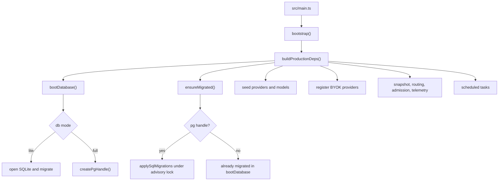
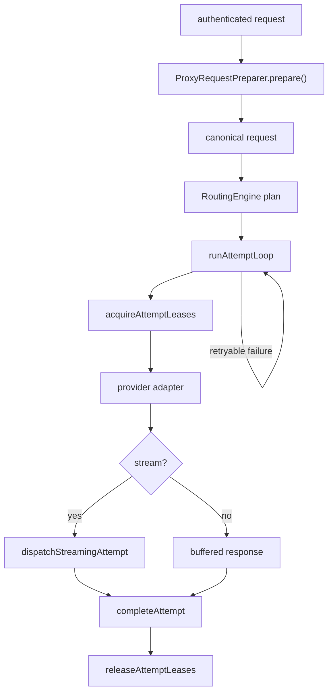

# Backend

`src/` is the production backend. It is one Elysia process. `src/main.ts` calls
`bootstrap()`, then `createGatewayApp()`. The app serves the public gateway, the
console API, and the built dashboard.

Dashboard code must not import this tree. Contracts cross the boundary as JSON.

## Boot

`buildProductionDeps()` in `src/boot/dependencies.ts` is the composition root.
It wires the database, Redis or memory, the provider registry, the route snapshot,
admission, the usage flush buffer, and the scheduled tasks. Lite migrates while
opening SQLite. Full migrates in `ensureMigrated()` under `pg_advisory_lock`.

Pool size is checked only for Full. `DATABASE_POOL_MAX` must be below the server's
`max_connections`. A server that refuses `SHOW max_connections` logs and continues.

## Public routes

Mounted by `createGatewayApp()` in `src/boot/app.ts`.

| Method | Path | Owner |
| --- | --- | --- |
| GET | `/health` | liveness, no dependency check |
| GET | `/health/ready` | migration ledger and dependencies |
| GET | `/metrics` | process metrics |
| POST | `/v1/chat/completions` | `handleProviderProxyRequest` |
| POST | `/v1/responses` | same proxy handler |
| POST | `/v1/responses/compact` | `createResponsesCompactHandler` |
| POST | `/v1/messages` | same proxy handler |
| POST | `/v1/completions` | same proxy handler |
| POST | `/v1/systemone` | `createSystemoneHandler` |
| POST | `/v1/search` | `createWebsearchHandler` |
| GET | `/v1/models` | model list |
| GET | `/v1/models/info`, `/v1/models/*` | model detail |
| POST | `/admin/drain` | drain, only when `CARTETHYIA_DRAIN_TOKEN` is set |

`/v1` is the public prefix. The proxy handler is one function for the four
translated surfaces. Compact, System One, and search have their own handlers
because they do not share the chat/response translation loop. Those handlers
still take the same preparer, snapshot, pool selector, and telemetry buffer.
If the buffer is not threaded in, the route writes no usage.

## Dispatch

`src/transport/dispatch/proxy-request.ts` owns `handleProviderProxyRequest`.
`runAttemptLoop` walks the plan. A retryable upstream failure releases the lease
and tries the next candidate. A terminal failure becomes a `GatewayError` and
stops.

Which failures are retryable is decided in `src/transport/failure-policy.ts`.
An overflow (`context_length_exceeded`) is retryable because it names how large
the prompt was against the window *that* candidate offered — a sibling with more
room is tried with the request unchanged. Nothing in the loop shrinks or rewrites
the prompt; a client that compacts does so on the 413 it receives once every
candidate has overflowed.

Streaming owns its own cleanup. `ProxyRequestStateStore.cleanup()` is the single
release point for a request: normal completion, error, cancel, client abort,
deadline, and stall. A pending pull owns its terminal outcome and must not be
released twice.

## Protocol

`src/protocol/canonical-model.ts` is the request the rest of the backend sees.
`src/protocol/registry.ts` encodes and decodes the three wire families.

| Wire family | Request encoder | Response decoder |
| --- | --- | --- |
| `chat` | `canonicalToChatPayload` | `parseChatResponseToEvents`, `decodeChatSseStream` |
| `responses` | `canonicalToResponsesPayload` | `parseResponsesResponseToEvents`, `decodeResponsesSseStream` |
| `messages` | `canonicalToClaudeMessagesPayload` | `claudeResponseToEvents`, `parseClaudeSseStream` |

`GatewayError` carries a stable code, an origin (`cartethyia`, `upstream`, or
`network`), and a public body. Provider adapters map upstream failures into that
type. They do not throw bare strings across the dispatch boundary.

Tool call identity is tracked in `src/protocol/tool-identity.ts` so a streamed
tool call keeps one id across deltas. Reasoning is one canonical part whether
the client sent a thinking block, `reasoning_content`, or a Responses reasoning
item. Empty reasoning is preserved. It is not invented.

## Providers

`src/providers/registry.ts` is the registry. `default-registry.ts` registers the
bundled adapters. `registerByokProviders` adds rows an operator created, and the
upstream host list used for SSRF is live: a provider added after boot is bound
on the next request, not at the next process start.

| Path | Role |
| --- | --- |
| `adapters/` | Per-provider HTTP and stream framing |
| `authentication/` | Token, OAuth refresh, credential envelope |
| `discovery/` | Offline catalog (`base-models.json`) and live probe |
| `operations/` | Account import, probe, enable, disable |
| `quota/` | Provider quota windows, not a routing floor |
| `specs/` | Declarative provider metadata |
| `search/` | Hosted search tools and grounding |

`base-adapter.ts` and `compatible-adapter.ts` cover providers that speak a
standard wire. A bespoke provider frames its own bytes in its adapter. That fact
lives on provider metadata, not in `wire_family`.

## Routing and network

`src/transport/routing/router.ts` plans. `route-model.ts` holds the snapshot
types and `InMemoryRouteSnapshotService`. `admission.ts` and `reservations.ts`
hold slots and leases. `round-robin.ts` keeps the per-provider cursor.

Provider strategy is `fallback` or `round_robin`. Pool strategy is `least_loaded`
or `round_robin`. Combo strategy is `fallback` or `round_robin`.

`src/network/pool/` selects an egress pool, checks its health, and accounts
bytes. `ssrf.ts` rejects destinations the policy does not allow. Custom provider
hosts go through that check. `retry.ts` is the outbound retry policy, distinct
from the routing failover loop.

## Security

| Module | Duty |
| --- | --- |
| `api-key-auth.ts` | Hash lookup, enabled check, scope check |
| `admission/` | Per-key and per-tenant concurrency, lifetime counters |
| `model-access-rule.ts` | `whitelist` or `blacklist` plus one `model_list` |
| `csrf.ts` | Console mutation token |
| `abuse.ts`, `model-abuse.ts` | IP and model abuse gates |
| `ip-boundary.ts` | Trusted proxy peer resolution |
| `crypto.ts` | Key hashing and secret encryption |

An API key no longer carries a provider allowlist. Model access is one mode and
one list. A key with `routing:invoke` does not silently gain `search:invoke`;
that grant is stored explicitly.

Console sessions are cookies. Expired sessions are deleted by the hourly
`console-session-sweep`. Login looks up a username and returns a user only when
exactly one row matches. Two tenants sharing a username do not guess.

## Persistence

`src/persistence/schema.ts` is the Drizzle source. `migrations/full-postgres/0000_baseline.sql`
must match it. Forward files are only:

| File | What an old database gains |
| --- | --- |
| `0001_converge_schema.sql` | Current columns, folded enums, model access, OAuth, CLI key scope |
| `0002_share_popups_and_usernames.sql` | Popup rows copied off `api_keys`, username unique per tenant |
| `0003_drop_fusion_and_minimum_balance.sql` | Fusion combos become fallback, floor columns dropped |

Stores live in `src/persistence/stores/` and under the console domain that owns
the table. `tenant-scope.ts` holds `globalOrOwnedBy`. A `NULL` tenant id is a
shared row. Replacing that with `eq(tenantId)` hides shared catalog rows. The
reverse is also wrong: quota and OAuth owner checks use `eq` on purpose.

`usage-flush.ts` coalesces admission counter writes. One update per key per
flush, not one update per request.

## Observability

`src/observability/event-log.ts` appends one JSON object per request to
`data/telemetry-events/YYYY-MM-DDTHH.jsonl`. Console usage, health, and share
stats read those files through `queryTelemetryEvents`. Lifetime totals stay in
`telemetry_usage_totals`.

`isGatewayError(status, httpStatus)` is the only error predicate. A 4xx, 499,
503, or 529 is recorded and is not counted as a gateway error.

`telemetry-buffer.ts` batches inserts. The file is appended after the aggregate
transaction commits. A rejected batch is not written once per retry. `tenantId`
must be a UUID or the batch is dropped.

`payload-capture.ts` writes bodies to frame files, one gzipped JSON frame per
capture. A row names its encoding: `jsonl-file` for a gzipped frame,
`jsonb-file` for a frame written before compression. `telemetry_payloads` is
the index. Retention prunes event files by hour prefix and does not touch the
current hour.

## Console API

`src/console/console-router.ts` mounts `/console/api`. CSRF and the mutation
limiter wrap every domain. `domain-registration.ts` attaches the domains.

| Prefix | Domain |
| --- | --- |
| `/console/api` auth routes | session, setup, lockout |
| `/providers` | catalog, detail, OAuth login |
| `/routing` | aliases and combos |
| `/network/pools` | egress pools |
| `/api-keys` | keys, share links, popups |
| `/cli-tools` | per-key CLI mappings |
| `/settings/runtime` | tenant preferences |
| `/backup` | export and restore, re-authenticates |
| `/studio` | model lab sessions |
| observability, live, logs, audit | usage, health, log ring, audit |

Share popups live in `share_popups`, keyed by `api_key_id`. The auth read does
not load image bytes. The popup is attached after the key read, or by a left
join on the public share path.

Backup restore drops columns listed in `LEGACY_DROPPED_COLUMNS`. An old backup
that still carries `share_popup_*`, `credit_limit`, or `used_at` restores. Those
columns are not recreated.

## Workers

`src/workers/` holds scheduled loops started from the composition root: telemetry
retention, session sweep, OAuth refresh, health sweep, and quota refresh. A loop
that needs the database takes the handle it was given at boot. It does not open
a second pool.

## Where to change what

| Change | Start here |
| --- | --- |
| New client field | `canonical-model.ts`, then both encoders and decoders that must carry it |
| New provider | `specs/`, adapter, registry, discovery catalog |
| Routing rule | `router.ts` and `route-model.ts`, then the snapshot builder |
| Console resource | the domain under `src/console/`, then the dashboard hook that calls it |
| Schema | `schema.ts`, `0000_baseline.sql`, next forward file `0004_*.sql` |
