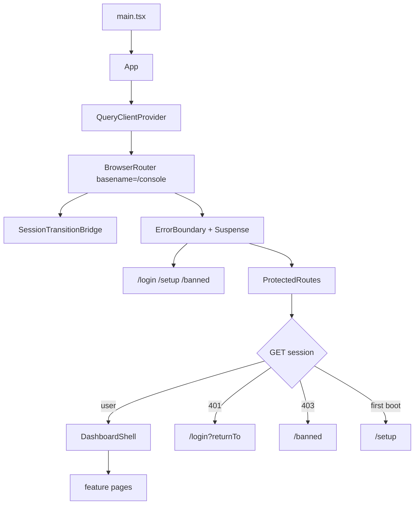
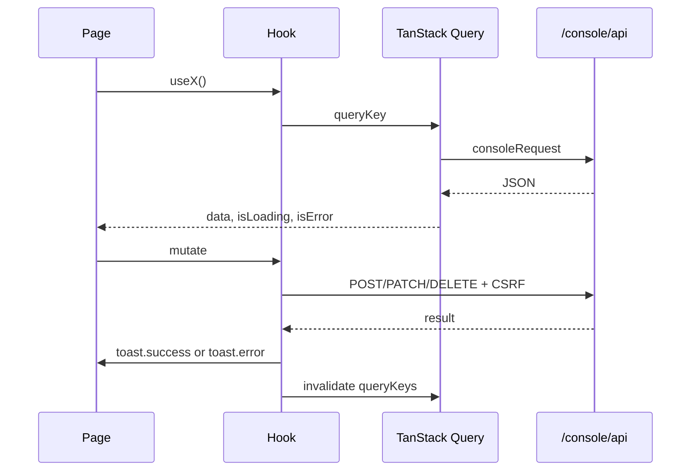

# Dashboard

`dashboard/src/` is the browser app. It is React, React Router, and TanStack
Query. The backend serves the built files at `/console`. The app's router
basename is `/console`, so a route written as `/usage` is `/console/usage` in
the browser.

The dashboard does not import Elysia, database drivers, filesystem modules, or
secrets. It calls `/console/api` through `dashboard/src/data/api.ts`.

## Shell

`ProtectedRoutes` fetches the session once, into `queryKeys.session.current`.
A later page reads that cache. It does not send a second session request on
every navigation. A 401 clears the cache and returns to login with the current
path. A 403 goes to `/banned`.

Route chunks are `lazyWithRetry`. After a deploy the old chunk URL 404s. The
loader reloads once to pick up the new `index.html`, then stops. It does not
loop.

## Pages

| Path | Page | What it operates |
| --- | --- | --- |
| `/` | `OverviewPage` | Tenant health and the first-look summary |
| `/usage` | `UsagePage` | Usage from the file log, grouped in the console |
| `/providers` | `ProvidersPage` | Provider catalog |
| `/providers/:providerId` | `ProviderDetailPage` | Accounts, auth, routing, models |
| `/combos` | `CombosPage` | Aliases and combos |
| `/quota` | `QuotaPage` | Provider quota windows |
| `/proxy` | `ProxyPage` | Network pools and egress |
| `/console-log` | `ConsoleLogPage` | Process log ring |
| `/model-lab` | `StudioPage` | Studio sessions against the gateway |
| `/cli-tools` | `CliToolsPage` | CLI tool list |
| `/cli-tools/:toolId` | `CliToolDetailPage` | Per-key slot mappings |
| `/settings` | `SettingsPage` | Runtime preferences, backup |
| `/login`, `/setup`, `/banned` | session pages | No shell |

Unknown protected paths redirect to `/`. There is no fusion page and no
minimum-balance editor.

Three of those pages are backed by a feature page that owns the data and the
console domain behind them: [`/combos`](../features/routing-aliases-combos.md),
[`/proxy`](../features/network-pools.md), and `/cli-tools`
([CLI model mapping](../features/cli-model-mapping.md)). The share page is public
and has its own: [share keys](../features/share-keys.md).

## Data flow

`dashboard/src/data/query-keys.ts` is the key tree. A mutation invalidates the
keys it changed. It does not write the server response over an unrelated cache
entry.

`query-client.ts` holds the shared client. `query-policy.ts` holds stale times.
`route-prefetch.ts` warms the next page's queries. `contracts.ts` is the
TypeScript shape of the JSON. If the console payload changes, this file changes
with it. The dashboard does not keep a second, drifted type.

`consoleRequest` attaches the CSRF header on mutations. A 401 or 403 notifies
`SessionTransitionBridge` through `setSessionTransitionListener`.

## Feature layout

| Directory | Holds |
| --- | --- |
| `features/session` | Login, setup, banned |
| `features/overview` | Home summary |
| `features/usage` | Usage charts and breakdowns |
| `features/providers` | Provider list |
| `features/provider-detail` | One provider: accounts, routing, models |
| `features/routing` | Combos and aliases |
| `features/quota` | Quota windows |
| `features/proxy` | Pool list and pool detail |
| `features/logs` | Console log |
| `features/studio` | Model lab |
| `features/cli-tools` | CLI tool mappings |
| `features/settings` | Preferences and backup |
| `apps/landing` | Public landing |
| `apps/share` | Public share page |
| `apps/console` | Console mount |
| `components/` | Shell, dialog, form controls |
| `hooks/` | Query hooks shared by more than one page |
| `lib/` | Toast, lazy retry, formatting |
| `styles/` | Tokens and layout |

A page-specific hook stays next to the page. A hook used by two features moves
to `dashboard/src/hooks/`.

## Share and landing

`apps/share` is the public page a share link opens: it reads the share API and
carries no probe, enable, disable, or delete controls. What the page is for, and
what enforces it, is on the [share keys](../features/share-keys.md) page.

`apps/landing` is the unauthenticated product page. Crawlers do not run the
bundle, so title, description, and social tags for landing, console, and share
are injected by `src/console/dashboard-assets.ts` into the one
`dashboard/index.html`. Do not add a second Vite HTML entry.

## Layout rules

The document is the only scroll container. `.app-topbar` and `.app-sidebar` are
sticky against it. A sticky toolbar uses `top: var(--topbar-height)`. It is a
sibling above the scrolling content, opaque, with its own shadow.
`.app-main-column`, `.dashboard-page`, and `.route-enter` do not scroll. The
sidebar collapses to a drawer on the shell's own width, not the viewport's.

Card blur only reaches the uploaded background when that image is painted behind the card in the same group. `BackgroundLayer` mounts inside `.app-main-column`. `.route-enter` animates position only — an `opacity`, `transform`, or `filter` animation groups the page, and the card then blurs the black body instead of the image. `.custom-background` keeps `contain: none` for the same reason; anything else also pins a `fixed` layer to the scroller. Clarity and blur are separate sliders.

Dialog sizes are `sm` 420, `md` 640, `lg` 880, `xl` 1160. An expanded dialog
caps at 1160. Below 640px the panel becomes a bottom sheet. New dialogs use
`DialogSize`, not a raw width.

`localStorage` keys are `cartethyia:<area>:<name>`. Reads check `typeof window`,
check the stored value against the allowed set, and fall back. A bad stored
value does not throw.

Polling lists sort with a deterministic tiebreaker. Two rows with the same
timestamp must not swap places between polls.

## Mutation feedback

Every mutation toasts both arms.

| Result | Toast |
| --- | --- |
| success | `toast.success` with the outcome, for example "Proxy pool created" |
| failure | `toast.error` with `getErrorMessage(error, ...)` |

A `mutate` that reports neither is a bug. The operator cannot tell whether the
click landed.

## Provider routing controls

`useRoutingStrategy` reads `GET` provider routing and writes it back through
`useUpdateProviderRouting`. Round robin is a boolean over the `round_robin`
strategy. Fallback is the other value. `rotateCount`, `maxInflight`,
`skipProxy`, and `userAgent` save through `useDebouncedSave`, so a slider
does not send one request per pixel.

User-agent editing is gated by `allowUserAgent`. Providers that must keep a
fixed agent do not show the field.

## Build and serve

`bun run dashboard:build` writes the static bundle. The backend serves it. The
dev server proxies `/console/api` to the gateway. A page that works in dev and
404s in production is almost always a basename or asset-path mistake, not a
data bug.

Social tags are verified on the served HTML, not in the React tree. The served
document for `/`, a console route, and a share route must each carry the tags
`dashboard-assets.ts` injects.

## Where to change what

| Change | Start here |
| --- | --- |
| New page | `App.tsx` route, feature directory, query key, console domain |
| New API field | console contract, then `data/contracts.ts`, then the hook |
| New dialog | `components/` dialog, `DialogSize`, both toast arms |
| Share page behavior | `apps/share`, and the share API it reads |
| Layout | `styles/` and `components/Shell.tsx` |
