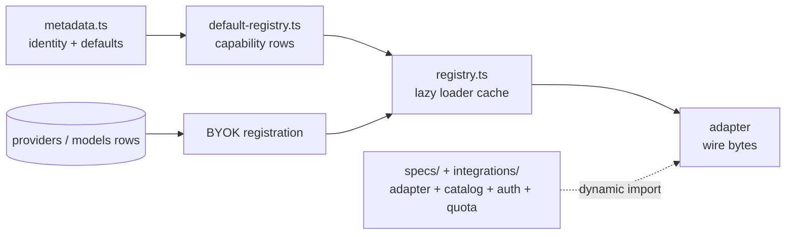

# Providers

`src/providers/` describes every upstream the gateway can dispatch to. A provider
is not a class and not a config file: it is a small set of declarations that four
layers read. Which layer owns a fact decides where a change goes.

This is the map. The procedure for adding, removing, importing, or authenticating
a provider belongs to `.skills/cartethyia-provider-catalog/SKILL.md`; account
health, cooldowns, and pool selection belong to
`.skills/cartethyia-health-routing/SKILL.md`. Neither is duplicated here.

## The layers

| Layer | Owns | File |
| --- | --- | --- |
| Metadata | Identity, base URL, default wire family, service kinds, whether an account is required, JWT verification defaults | `src/providers/metadata.ts:27` |
| Spec | The declarative contract for one bearer-authenticated OpenAI-compatible provider — data only, no behavior | `src/providers/integrations/shared/configured-provider.ts:24` |
| Registry | One registration authority; lazy loader cache for adapter, auth, quota, and discovery | `src/providers/registry.ts:114` |
| Registration source | Which module each bundled provider's capabilities come from | `src/providers/default-registry.ts:82` |
| Adapter | Provider wire bytes | `src/providers/base-adapter.ts:19`, `src/providers/compatible-adapter.ts:138` |
| Integration | Per-provider adapter, catalog, OAuth client, quota collector | `src/providers/integrations/<family>/` |
| Discovery | Live model listing and one-shot probes | `src/providers/discovery/` |
| Operations | Seeding, BYOK wiring, account health, CLI identity, versions | `src/providers/operations/` |
| Quota | Provider billing windows | `src/providers/quota/` |

The split matters because a provider is reached through *dynamic* `import()`.
`PROVIDER_CAPABILITIES` (`src/providers/default-registry.ts:82`) holds no
adapter instance, only loaders: `loadAdapter`, `loadModels`,
`loadAuthentication`, `loadQuotaCollector`, `loadModelDiscovery`. Nothing in
`src/providers/integrations/` is evaluated until a provider is actually
dispatched to, probed, or refreshed. That is why a protobuf-heavy family costs
nothing at boot — and why "grep finds no static import of this module" is not
evidence that it is dead.

## Boot, and bundled vs BYOK

`buildProductionDeps()` is the only place these steps run, in this order
(`src/boot/dependencies.ts:130-142`):

1. `seedBundledProviders(db)` — upserts one `providers` row per bundled module
   (`src/providers/operations/provider-catalog-service.ts:32`). Additive; it
   never deletes.
2. `retireUnbundledProviders(db)` — deletes unowned rows the bundle no longer
   declares (`:88`). Boot-only, because the test harness shares one database and
   a delete there would race other suites' fixtures.
3. `createDefaultProviderRegistry()` — registers every bundled module
   synchronously (`src/providers/default-registry.ts:499`). Registration is
   cheap; only the loaders are lazy.
4. `liveProviderUpstreamHosts(registry)` — a closure over the registry, not a
   snapshot, so a provider registered after boot resolves its SSRF binding on
   the next request (`provider-catalog-service.ts:112`).
5. `registerByokProviders(registry, db, ssrfPolicy)` — reads every
   `providers` row with a non-null `base_url` and `enabled = true` and registers
   it as an `OpenAICompatibleAdapter` (`:182`).
6. `bundledModelCatalog(registry)` then `seedBundledModels(db, …)` — materialize
   static catalogs into `models` (`:126`, `provider-catalog-seeder.ts:8`).

**Bundled** means the id is in `RAW_BUNDLED_PROVIDER_METADATA`
(`src/providers/metadata.ts:27`). That is the whole test:
`isBundledProviderId` (`src/providers/contracts.ts:200`) answers from that list.
A bundled provider has a `ProviderModule` row composed from metadata and a
`PROVIDER_CAPABILITIES` entry, and `BUNDLED_PROVIDER_MODULES`
(`default-registry.ts:474`) throws at module load if an id has metadata but no
implementation.

**BYOK** (also called custom, or configured) means a `providers` row carrying a
`base_url`. It is tenant-owned, its slug must not collide with a bundled id
(`parseCustomProviderId`, `contracts.ts:215`), and it always dispatches through
`OpenAICompatibleAdapter` — no bespoke wire, no OAuth, no quota collector. Its
wire contract is derived by `resolveByokWireProfile`
(`src/providers/operations/byok-wire-profile.ts:55`) from the row's
`wire_family_default` and `compatibility_profile`; that function is the
authority, and re-hardcoding header or wire mappings elsewhere is the recurring
bug the catalog skill warns about.

Re-registration is idempotent by fingerprint, not by error: `upsert`
(`registry.ts:163`) replaces an existing registration and drops the cached
adapter, so an operator editing a BYOK row from the console changes dispatch
behavior without a restart.

## Credentials and auth

`CredentialKind` is a closed union: `none`, `api_key`, `oauth`,
`scoped_access_token`, `workload_identity` (`src/providers/contracts.ts:18`).
The storage enum is narrower — `api_key`, `oauth`, `none`
(`src/persistence/schema.ts:106`).

| Shape | Where the secret lives | Where the rest lives |
| --- | --- | --- |
| API key | `provider_accounts.credential_ciphertext` (encrypted) | — |
| OAuth | same column, access token | `provider_oauth_states` (`schema.ts:238`): refresh ciphertext, optional client-secret ciphertext, `expires_at`, refresh lease |
| Device code | mints one of the two above | — |
| No credential | nothing; `requires_account = false` and `credential_forwarding: "never"` | — |

`provider_accounts.auth_state` (`schema.ts:195`) holds non-secret per-account
upstream configuration — region, profile ARN, OAuth client id, token endpoint.
It travels beside the secret in `ResolvedCredential.auth_state`
(`src/providers/contracts.ts:35`) because a single opaque credential string
cannot express both, and the request an adapter builds depends on both.

Selection is `CredentialResolver` (`src/providers/credential-resolver.ts:33`):
the first usable alternative in operator order. Decryption and caching live in
`src/providers/operations/provider-credential-service.ts`, with a 5 s TTL keyed
on `providerId:accountId` (the provider must be in the key — a routing candidate
can reuse another provider's account id).

`TokenEnvelope` (`src/providers/credential-envelope.ts`) strips one explicitly
identified prefix — `Bearer `, `OAuth `, `provider:` — so an adapter never emits
`Bearer Bearer`. It is a separate module because adapters consume it and the
registry imports adapters; the reverse edge would be a cycle.

Three auth client shapes exist:

| Shape | Base class | Family examples |
| --- | --- | --- |
| Browser PKCE | `OAuthClient.buildAuthorizeUrl`/`exchangeCode` (`src/providers/authentication/oauth-client.ts:61,95`) | claude, antigravity, kiro, codex, mimodesktop, mimostudio, openrouter, zcode |
| Device code (RFC 8628) | `OAuthDeviceFlow` (`src/providers/authentication/oauth-device-flow.ts:26`) | codex, github, cursor, grok, xai, kimi, cline, kiro, kilo, muse, qoder |
| No OAuth | plain key path; `probeApiKeyConnectivity` is the account test (`src/providers/quota/quota-support.ts:16`) | openai, anthropic, mistral, meta, most `specs/` providers |

Whether a refresher is registered is per-family and deliberate. A family whose
grant is absent or dead registers no refresher, because a refresh call that
always throws turns a recoverable 401 into a permanent one — see the comments on
`kilo` (`:351`), `qoder` (`:369`), `openrouter` (`:387`), and `zcode` (`:421`) in
`default-registry.ts`. GitHub is the opposite case: its Copilot token is
short-lived and re-minted from the device-flow token, so it does register one
(`:446`).

Some issuers publish a JWKS; `metadata.ts:59` and `:74` declare `issuer` and
`jwksUrl` for `grok` and `xai`, and `jwtVerification` (`:258`) is the field.
Providers without one get registered-claim validation only.

## Discovery and catalog

A model becomes routable when a `models` row exists with `enabled = true` and
its provider row is enabled and not retired. Two writers produce those rows.

**Static catalogs.** Each bundled module declares `loadModels`, usually a module
constant built with `defineModel` (`src/providers/model-definition.ts:154`).
`defineModel` resolves limits and pricing against the offline base catalog and
leaves capability flags to the caller — capability does not fall back, because
an invented default is worse than a stated false. The offline catalog is
`src/providers/discovery/base-models.json` (~2 MB, `source: models.dev`,
`fetchedAt` in the file header), read by
`src/providers/discovery/models-dev-catalog.ts:1`. Provider ids that differ from
models.dev's spelling are remapped in `MODELS_DEV_PROVIDER_IDS` (`:139`).
`seedBundledModels` (`src/providers/operations/provider-catalog-seeder.ts:8`)
writes these rows as `source: 'builtin'`, prunes `(model, endpoint)` pairs the
catalog no longer declares, and reconciles capability drift on conflict while
leaving operator-owned `enabled` alone.

**Live discovery.** A module's `loadModelDiscovery` is a
`ProviderModelDiscovery` (`src/providers/discovery/discovery-types.ts:33`) taking
`baseUrl`, `credential`, optional `fetcher`, and optional `authState`. Most
OpenAI-compatible providers reuse `fetchOpenAICompatibleModels`
(`src/providers/discovery/openai-model-discovery.ts:25`). Per-account catalogs
declare `modelDiscoveryRequiresCredential: true` — Kiro's list answers with what the credential's plan reaches, so the
static rows are only an offline seed. Persisted rows get `source: 'discovered'`
or `'auto_free'` (`src/providers/discovery/probing-service.ts:800`), which keeps
a free-tier row distinguishable at the only point it is still known.

Static and discovered rows are not rivals: discovery adds to the static floor
and never resets `enabled`. Catalog presence is not availability — a row is not
proof that a model answers. `/v1/models` reads the same rows.

## Quota and health

`QuotaFetcher` (`src/providers/quota/quota-support.ts:60`) is a per-provider
callback returning `ProviderQuotaResult` (`quota-contracts.ts:17`): a plan label
and a list of windows with percentages and reset times. Registered collectors are
resolved lazily through the registry (`:67`). Quota is **display**, not a routing
floor — there is no minimum-balance gate, and `totalRemainingCredit` (`:40`)
deliberately ignores percentage-only windows because 0–100 is utilization, not a
balance. Health state lives on `provider_accounts` via `healthColumns()`
(`src/persistence/schema.ts:93,198`): status, `cooldown_until`, per-model
cooldowns, last error category. Cooldown classes, recovery sweeps, leases, and
pool selection are owned by `.skills/cartethyia-health-routing/SKILL.md`.

## Per-family notes

Only what is verified in code. `bespokeWire` means the adapter frames its own
protocol instead of going through a canonical codec (`metadata.ts:316`).

| Family | What is non-standard |
| --- | --- |
| kiro | Bespoke (`metadata.ts:112`). AWS EventStream wire over `q.us-east-1.amazonaws.com`, no chat-shaped endpoint; reasoning arrives either as its own event or as `<thinking>` markers inside text (`kiro-stream.ts:1`). Device + PKCE. |
| cursor | Bespoke (`metadata.ts:118`). Connect-RPC over HTTP/2: unary calls send `application/proto`, the turn is a bidirectional `application/connect+proto` frame stream opened on `node:http2` because `fetch` cannot hold it (`cursor-transport.ts:1-9`). Catalog is per-account. |
| github | Base URL is only a fallback: the real host is read from the Copilot token's `proxy-ep` claim per dispatch (`github.ts:5`). Short-lived token, real refresher. |
| antigravity | Google OAuth, but the wire is a Gemini payload wrapped in an agent envelope POSTed to `v1internal:{generate,stream}GenerateContent` — no per-model path (`antigravity.ts:1-12`). Image generation streams that same envelope with `responseModalities: ["IMAGE"]` and reads `inlineData`. |
| muse | Device-code login yields an OAuth token, which a follow-up `POST /muse-code/key` exchanges for the `api_key` the model backend accepts; the stored `oauth` secret is a `{oauthAccessToken, apiKey}` JSON blob (`muse.ts:1-12`). |
| meta | The *other* Meta surface: a plain developer-dashboard API key, no OAuth (`default-registry.ts:172`). |
| claude / codex | Subscription OAuth on Messages / Responses. Codex also serves websearch (`metadata.ts:43`). Its image path is separate from the chat turn: a Responses `image_generation` tool on a chat carrier, without the chat identity envelope. A catalog row is not an entitlement; a ChatGPT account can reject the tool. |
| gemini | `x-goog-api-key` header, per-model `:generateContent`/`:streamGenerateContent` paths; not [OI]-shaped (`adapters/gemini.ts:2-3`). Image generation uses the same path and asks for `responseModalities: ["IMAGE"]` only. |
| xai / grok | Same issuer and JWKS, different surfaces: `grok` is the free Grok Build CLI proxy, `xai` is the paid API (`metadata.ts:64-78`). |
| kilo | Resells the OpenRouter catalog behind a `{accessToken, orgId}` JSON credential decoded at the auth boundary (`kilo.ts:1-14`). No refresh grant. |
| qoder | Device flow whose refresh endpoint answers 403; no refresher (`default-registry.ts:369`). |
| cline | Discovery reads only `recommended` + `free` — asking for the pass roster would write subscription rows an operator's account can only 401 on (`default-registry.ts:314-324`). |
| openrouter / zcode | PKCE ends by minting a **durable API key**, not an access token, so no refresher is registered (`:387`, `:421`). |
| xiaomi-mimo | Four ids: `xiaomipg`, `xiaomitp` (both key-based), `mimodesktop` (OAuth), `mimostudio` (browser cookies pasted from a signed-in session, `metadata.ts:182`). |
| cb / cbcn / workbuddy | One billing system, so `BUDDY_PROVIDER_IDS` (`metadata.ts:251`) names the family for health, request prep, and daily check-in. |
| opencodeft | `requires_account: false` and `ipScopedRateLimit: true` (`metadata.ts:124`): rate limits follow the egress address, so a 429 cools the pool, not the account. |
| exa | `serviceKinds: ["websearch"]` only; served by `/v1/search`, never by the chat pipeline (`metadata.ts:197`). |
| mistral, fireworks, nvidia, gmi, ollamacloud, deepseek | One shared spec, no module of their own: bearer + `/v1` paths (`specs/configured-openai-providers.ts:13`). |

## Where to change what

| Change | Start here |
| --- | --- |
| New provider, family, or catalog row | `.skills/cartethyia-provider-catalog/SKILL.md` |
| Provider identity, base URL, default wire, service kinds | `src/providers/metadata.ts:27` |
| Wire a bundled provider's adapter/auth/quota/discovery | `src/providers/default-registry.ts:82` |
| Behavior of one provider's wire | its module under `src/providers/integrations/<family>/` or `src/providers/adapters/` |
| A provider that speaks standard OpenAI chat/responses | add an `ApiKeyProviderSpec`, not an adapter (`integrations/shared/configured-provider.ts:24`) |
| Shared HTTP/SSE adapter behavior | `src/providers/compatible-adapter.ts:138`, `base-adapter.ts:19` |
| Provider registration, caching, lazy loading | `src/providers/registry.ts:114` |
| BYOK wire/header derivation | `src/providers/operations/byok-wire-profile.ts:55` |
| BYOK registration and SSRF binding | `src/providers/operations/provider-catalog-service.ts:182` |
| Static catalog seeding and drift | `src/providers/operations/provider-catalog-seeder.ts:8` |
| Offline limits and pricing | `src/providers/discovery/base-models.json`, `models-dev-catalog.ts:139` |
| Live model listing | the family's `loadModelDiscovery`, or `discovery/openai-model-discovery.ts:25` |
| Quota windows | the family's `*-quota.ts` collector, plus `src/providers/quota/quota-contracts.ts:1` |
| OAuth login, refresh, device flow | `src/providers/authentication/`, then the family's `*-oauth.ts` |
| Account health, cooldowns, pool selection | `.skills/cartethyia-health-routing/SKILL.md` |
