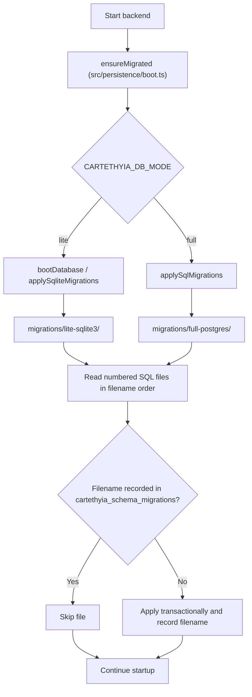

# Database migrations

Cartethyia ships one migration set per database backend:

- `full-postgres/` contains PostgreSQL SQL.
- `lite-sqlite3/` contains SQLite SQL.

Both sets use the same numbered filenames and the same
`cartethyia_schema_migrations` ledger. The active backend applies its own set
automatically during startup; operators do not choose files or run SQL
manually.

## Current state

- `0000_baseline.sql` in `full-postgres/` declares the complete PostgreSQL
  schema for a new database. Keep it aligned with
  `src/persistence/schema.ts`.
- `lite-sqlite3/0000_baseline.sql` is generated from that PostgreSQL baseline
  by `scripts/generate/sqlite-ddl.ts`. Regenerate it with
  `bun scripts/generate/sqlite-ddl.ts`; do not edit it by hand.
- Both directories currently contain matching migrations numbered `0000`
  through `0013`. Each forward migration has a same-named SQLite counterpart;
  `test/persistence/sqlite-baseline.test.ts` checks both the filename parity
  and generated baseline. A new database starts from its backend's current
  baseline, while older databases apply the forward migrations they have not
  recorded.
- If an existing database already has the `tenants` table but has no ledger
  entry for the current `0000_baseline.sql`, the runner records that baseline
  as satisfied rather than executing it again. The later forward migrations
  still run.
- PostgreSQL migration discovery and application are in
  `src/persistence/migrate.ts` and `src/persistence/db-pg.ts`. The runner
  resolves the package's `migrations/full-postgres/` directory, reads only
  top-level `NNNN_*.sql` files in filename order, and applies each file in a
  transaction under a cross-process advisory lock. SQLite uses
  `src/persistence/db-sqlite.ts` and its own directory; it splits files at
  statement breakpoints and applies each file transactionally. Lite is
  single-process and uses no advisory lock.
- `src/boot/dependencies.ts` calls `ensureMigrated()` before provider/catalog
  seeding. Readiness compares the migration ledger against the shipped
  migration filenames. A failed migration aborts startup and does not record
  the failed filename.
- Migrations are package assets, not resolved from the process working
  directory: `src/config/package-paths.ts` resolves them from the package
  root. `package.json` includes `migrations/` in the published files, and the
  Dockerfile copies both sets into `/app/migrations`.

## Next schema change

1. Change `src/persistence/schema.ts` and update
   `full-postgres/0000_baseline.sql` to describe the complete current schema
   for fresh PostgreSQL installations.
2. Regenerate the SQLite baseline with
   `bun scripts/generate/sqlite-ddl.ts`. Do not edit the generated SQLite
   baseline directly.
3. Add the next `<NNNN>_<description>.sql` forward migration in
   `full-postgres/`, choosing a number one higher than the highest migration
   already shipped there (`0014` follows the current `0013`). Add a SQLite
   counterpart with the **same filename** in `lite-sqlite3/`. The SQL may
   differ by dialect; keep both changes compatible with their respective
   runners and use statement breakpoints.
4. Make forward migrations safe to retry where possible. SQLite does not
   accept `ADD COLUMN IF NOT EXISTS` in this runner; spell column adds as
   `ADD COLUMN`, which the runner skips if the column already exists. Do not
   put runnable SQL in a `manual/` subdirectory: discovery is non-recursive.
   Never edit or delete a shipped forward migration, because existing ledgers
   depend on its filename and meaning.
5. Update this README if the migration flow or schema policy changes. Run
   `bun run typecheck`, the focused migration/baseline tests, and verify a
   fresh schema and forward upgrade against an isolated database.

The baseline is for new databases. Editing it cannot upgrade a database that
already recorded it; every later schema change therefore needs the matching
numbered forward SQL in both migration sets. The selected runner applies the
forward migration at startup before serving requests.
